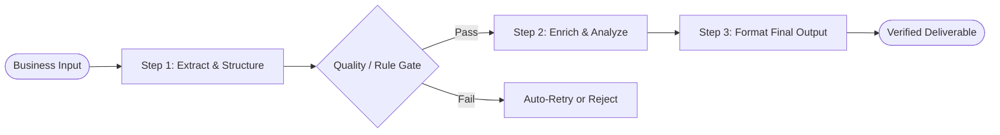

# 01. Prompt Chaining

[← Back to Playbook Overview](../README.md)

## a) What is this pattern?

Think of **Prompt Chaining** like a modern factory assembly line. Instead of asking one worker to build an entire car from scratch in a single room, each station performs one specific job—stamping the frame, painting the body, installing the engine-and quality-checks the part before passing it down the line. In AI, Prompt Chaining breaks a complex business task into a fixed sequence of smaller, focused AI steps with automated rule checks between each step.

---

## b) Why this pattern?

### The Business Problem
When enterprises try to cram a multi-step business process (such as extracting data, checking policy compliance, and drafting a legal response) into a single "mega-prompt," the AI gets overwhelmed. It forgets instructions, hallucinates details, and becomes impossible to debug when something goes wrong.

### Return on Investment (ROI)
- **Higher Accuracy at Lower Cost:** Smaller, focused steps allow you to use faster, cheaper AI models for simple stages instead of paying for a massive frontier model for the entire workflow.
- **Pinpoint Predictability & Compliance:** Programmatic quality gates between steps catch errors immediately, cutting downstream rework and compliance incidents by **60–80%**.
- **Easy Maintenance:** Updating one business rule means tweaking a single station on the assembly line rather than re-testing the entire system.

---

## c) When to use?

### Decision Checklist
- [x] The business process follows a **clear, repeatable sequence of steps** (Step A always happens before Step B).
- [x] A single prompt frequently misses instructions, drops formatting, or produces inconsistent quality.
- [x] You need **hard compliance or data-validation checks** between stages before proceeding.
- [x] You want to trade a small amount of extra wait time (sequential steps) for much higher reliability.
- [ ] *Avoid when:* The task requires open-ended exploration where the steps cannot be predicted in advance (use [04. Tool Use & ReAct](../04-tool-use-react/) or [05. Planning](../05-planning/) instead).

### High-Level Architecture

---

## d) Scorecard & Eval Pass/Fail

| Metric | Target Benchmark | Pass Criteria (Go-Live) | Fail Criteria (Block Release) |
|---|---|---|---|
| **Accuracy** | Step-by-step schema adherence & final output accuracy | **≥ 98%** pass rate across intermediate gates; **≥ 95%** final task accuracy | **< 95%** intermediate gate pass rate or any unvalidated data leaking to final step |
| **Cost** | Total cost per completed workflow (`\$` / task) | **≤ \$0.03** per workflow execution (blending small & medium models) | **> \$0.08** per execution due to excessive retries at intermediate gates |
| **Latency** | End-to-end processing time (p95) | **≤ 5.0 seconds** total across a 3-step chain | **> 10.0 seconds** end-to-end or frequent timeout cascades |
| **Reliability / Business Value** | First-pass automation rate without human rework | **≥ 90%** straight-through processing rate | **< 80%** straight-through processing or **> 2%** silent formatting failures |

---

## e) Use Cases

### 1. Retail: Automated Product Catalog Onboarding
- **Scenario:** A retailer receives messy supplier spec sheets in PDF/CSV format. 
    - Step 1 extracts product attributes into a standard structure; the Gate verifies mandatory fields (SKU, material, dimensions); 
    - Step 2 writes SEO-friendly product copy matching brand tone; 
    - Step 3 translates the listing into regional languages.
- **Business Benefit:** Eliminates manual copywriting bottlenecks and prevents incomplete or off-brand listings from going live.
- **Primary KPI:** **Time-to-Site (Catalog Onboarding Cycle Time)** reduced from 5 days to **under 10 minutes** (+40% faster seasonal launch velocity).

### 2. Banking: Commercial Loan Covenant Extraction & Summary
- **Scenario:** Credit analysts upload 150-page commercial loan agreements. 
    - Step 1 extracts financial covenants and dates; the Gate verifies that every extracted clause has an exact page/paragraph citation; 
    - Step 2 compares covenants against standard bank risk policy; 
    - Step 3 drafts an executive credit memo.
- **Business Benefit:** Ensures zero hallucinated clauses in credit committee memos while freeing analysts from tedious document review.
- **Primary KPI:** **Underwriting Review Cycle Time** reduced by **65%**, with **100% citation verification accuracy**.

### 3. Healthcare: Clinical Discharge Summary & Patient Instructions
- **Scenario:** When a patient is discharged, 
    - Step 1 extracts diagnoses, medications, and follow-up dates from physician notes; the Gate cross-checks medication dosages against the EHR order list; 
    - Step 2 rewrites care instructions at a 6th-grade reading level in the patient's preferred language; 
    - Step 3 generates a structured follow-up checklist.
- **Business Benefit:** Improves patient comprehension of post-hospital care while ensuring strict clinical accuracy on medication instructions.
- **Primary KPI:** **30-Day Readmission Rate** reduced by **12–18%** and **Clinician Documentation Time** cut by **15 minutes per discharge**.

---

## f) Foundational arXiv Papers & Further Reading

- **[AI Chains: Transparent and Controllable Human-AI Interaction by Chaining Large Language Model Prompts (arXiv:2203.06566)](https://arxiv.org/abs/2203.06566)** — Demonstrates how decomposing monolithic tasks into modular prompt chains improves accuracy, transparency, and human controllability.
- **[PromptChainer: Chaining Large Language Model Prompts through Visual Programming (arXiv:2203.06566)](https://arxiv.org/abs/2203.06566)** — Explores structured data transformations and validation gates between sequential LLM steps.
- **[Chain-of-Thought Prompting Elicits Reasoning in Large Language Models (arXiv:2201.11903)](https://arxiv.org/abs/2201.11903)** — The foundational paper on step-by-step reasoning decomposition.
- **[Least-to-Most Prompting Enables Complex Reasoning in Large Language Models (arXiv:2205.10625)](https://arxiv.org/abs/2205.10625)** — Breaks complex problems into sequential subproblems solved in order.
- **[Building Effective Agents (Anthropic Engineering)](https://www.anthropic.com/engineering/building-effective-agents)** — Industry reference defining Prompt Chaining with programmatic gates as the primary deterministic workflow pattern.

