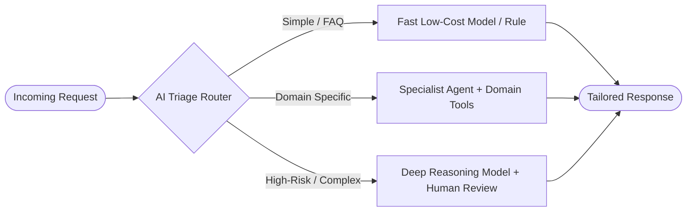

# 02. Routing

[← Back to Playbook Overview](../README.md)

## a) What is this pattern?

Think of **Routing** like an experienced hospital triage nurse or a smart corporate receptionist. When a request walks through the door, the receptionist doesn't try to perform surgery or file corporate taxes themselves—they quickly assess the request's intent, urgency, and complexity, and immediately direct it to the right specialist department. In AI, a fast classifier examines incoming requests and routes them to the right specialized prompt, workflow, or model tier.

---

## b) Why this pattern?

### The Business Problem
Organizations handle thousands of wildly different requests every day—from simple password resets and order status checks to complex contract disputes and VIP escalations. Using one giant, expensive AI model with a bloated instruction manual for every single request wastes money on easy tasks and underperforms on specialized tasks.

### Return on Investment (ROI)
- **Drastic Cost Reduction (Cascade Routing):** Sending 70–80% of routine requests to fast, low-cost models (or deterministic code) and reserving premium reasoning models only for hard problems cuts AI inference spend by **50–75%**.
- **Higher Specialist Quality:** Each downstream path has its own tailored instructions, examples, and tools without conflicting rules from unrelated departments.
- **Faster Response Times:** Routine inquiries get sub-second answers instead of waiting for a heavy general-purpose model.

---

## c) When to use?

### Decision Checklist
- [x] Incoming inputs fall into **distinct categories, intents, or complexity tiers** (e.g., Billing vs. Technical Support vs. Legal Escalation).
- [x] Tuning prompt instructions to improve one category keeps breaking performance on other categories.
- [x] You want to optimize **Cost vs. Quality** by matching easy queries to small models and hard queries to frontier models.
- [x] Some categories can be handled by deterministic rules/APIs without needing generative AI at all.
- [ ] *Avoid when:* Every single request requires all domains simultaneously (use [03. Parallelization](../03-parallelization/) or [07. Multi-Agent Orchestrator](../07-multi-agent-orchestrator/) instead).

### High-Level Architecture

---

## d) Scorecard & Eval Pass/Fail

| Metric | Target Benchmark | Pass Criteria (Go-Live) | Fail Criteria (Block Release) |
|---|---|---|---|
| **Accuracy** | Classification / routing precision & recall | **≥ 96%** routing accuracy; **≥ 99%** recall on high-risk/escalation categories | **< 93%** overall routing accuracy or any high-risk request misrouted to a low-tier flow |
| **Cost** | Blended cost per 1,000 requests | **≥ 50% cost reduction** compared to routing 100% of traffic to the largest model | Blended cost within **10%** of all-frontier baseline (router overhead outweighs savings) |
| **Latency** | Triage classification overhead (p95) | **≤ 300 ms** for routing decision; **≤ 1.5s** end-to-end for fast-lane queries | **> 800 ms** just to classify intent |
| **Reliability / Business Value** | First-Contact Resolution (FCR) & fallback safety | **100%** of low-confidence classifications (< 0.80) safely fall back to default/human queue | Misrouted customers forced to repeat information or stuck in dead-end queues |

---

## e) Use Cases

### 1. Retail: Omnichannel Customer Service Triage
- **Scenario:** Customer messages arrive via chat, email, and SMS. The Router classifies each message by intent and sentiment: "Where is my order?" goes to a fast API lookup workflow; "Damaged item refund under \$50" goes to an automated refund policy flow; "Angry VIP customer or safety complaint" routes immediately to a senior human specialist with a drafted summary.
- **Business Benefit:** Resolves routine volume instantly at fractions of a cent while protecting brand reputation on sensitive issues.
- **Primary KPI:** **Cost per Contact** reduced by **60%** and **First-Contact Resolution (FCR)** increased by **25%**.

### 2. Banking: Fraud & Dispute Intake Triage
- **Scenario:** When cardholders report an issue, the Router distinguishes between a simple merchant billing inquiry (e.g., unrecognized store name), a lost/stolen card requiring immediate freeze, and complex wire/authorized-push-payment fraud requiring forensic investigation.
- **Business Benefit:** Freezes compromised cards in seconds while ensuring complex regulatory disputes go straight to specialized compliance workflows.
- **Primary KPI:** **Mean Time to Mitigate (MTTM) Fraud Losses** cut by **70%** and **False-Positive Dispute Filings** reduced by **30%**.

### 3. Healthcare: Patient Portal Message Triage
- **Scenario:** Patients send thousands of daily messages through the health portal. The Router classifies messages into: administrative requests (prescription refills, appointment scheduling), non-urgent clinical questions (routed to nursing staff with relevant chart context), and urgent red-flag symptoms like chest pain (instant emergency escalation protocol).
- **Business Benefit:** Prevents physician burnout from administrative inbox overload and ensures urgent clinical symptoms are never buried in a backlog.
- **Primary KPI:** **Physician Inbox Volume** reduced by **45%** and **Urgent Symptom Escalation Time** reduced to **< 30 seconds**.

---

## f) Foundational arXiv Papers & Further Reading

- **[FrugalGPT: How to Use Large Language Models While Reducing Cost and Improving Performance (arXiv:2305.05176)](https://arxiv.org/abs/2305.05176)** — Introduces cascade routing and model selection strategies that cut inference costs by up to 90% while matching or beating the largest model's accuracy.
- **[RouteLLM: Learning to Route LLMs with Preference Data (arXiv:2406.18665)](https://arxiv.org/abs/2406.18665)** — Trains lightweight router classifiers to dynamically dispatch easy queries to small models and complex queries to frontier models.
- **[Hybrid LLM: Cost-Efficient and Quality-Aware Query Routing (arXiv:2404.14618)](https://arxiv.org/abs/2404.14618)** — Demonstrates quality-aware query routing across small and large models based on predicted query difficulty.
- **[Building Effective Agents (Anthropic Engineering)](https://www.anthropic.com/engineering/building-effective-agents)** — Industry reference for intent and complexity routing across specialized prompts and models.

