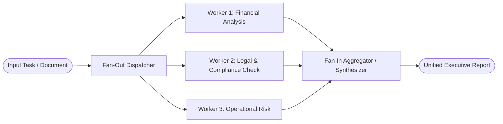

# 03. Parallelization (Fan-Out / Fan-In)

[← Back to Playbook Overview](../README.md)

## a) What is this pattern?

Think of **Parallelization** like a pit crew at a Formula 1 race or a panel of three independent home inspectors. Instead of one mechanic changing all four tires one by one, four mechanics work at the exact same time (**Sectioning**) so the car is back on the track in seconds. Or, for a high-stakes decision, three inspectors examine the same house independently and compare notes (**Voting**) so no hidden defect is missed. In AI, Parallelization runs multiple focused tasks concurrently and combines their results into a single answer.

---

## b) Why this pattern?

### The Business Problem
Sequential AI workflows become painfully slow when analyzing large documents, checking dozens of compliance rules, or researching multiple data sources. Worse, when a single AI model both writes a response and checks its own safety in the same prompt, it suffers from "tunnel vision" and often misses subtle policy violations.

### Return on Investment (ROI)
- **Dramatic Speedup:** Running 5 independent analysis tasks simultaneously cuts total wait time from 25 seconds down to **5 seconds**—critical for live customer or employee experiences.
- **Higher Quality via Separation of Concerns:** Dedicated parallel workers focus on one rubric each (e.g., Legal Risk, Financial Math, Brand Tone) without diluting attention.
- **Consensus Confidence (Voting):** Cross-checking critical decisions across multiple independent prompts or models eliminates single-model blind spots and reduces costly false positives.

---

## c) When to use?

### Decision Checklist
- [x] A complex task can be split into **independent subtasks** that do not depend on each other's outputs (**Sectioning**).
- [x] End-to-end speed (latency) is critical, and waiting for sequential steps is too slow for the user.
- [x] You want to run **guardrail/safety checks in parallel** with content generation so safety doesn't slow down the app.
- [x] The decision is high-stakes and benefits from **multiple independent perspectives or majority voting** (**Voting / Ensembling**).
- [ ] *Avoid when:* Step B strictly requires the output of Step A to know what to do (use [01. Prompt Chaining](../01-prompt-chaining/) instead), or when token budgets are extremely tight.

### High-Level Architecture

---

## d) Scorecard & Eval Pass/Fail

| Metric | Target Benchmark | Pass Criteria (Go-Live) | Fail Criteria (Block Release) |
|---|---|---|---|
| **Accuracy** | Defect detection recall & synthesis completeness | **≥ 97%** recall across all parallel rubrics; **0** dropped worker findings in final synthesis | Single-worker findings omitted by aggregator or **< 92%** agreement on voting benchmarks |
| **Cost** | Fan-out token multiplier (`O(n)` budget control) | Total fan-out cost stays **≤ \$0.06** per task with bounded worker count ($n \le 5$) | Unbounded fan-out causing **> 5x** cost spikes without measurable quality lift |
| **Latency** | Wall-clock time vs. sequential baseline (p95) | Total latency **≤ 1.2x** the slowest single worker (e.g., **≤ 4s** for 4 parallel 3s tasks) | Straggler workers or lack of timeouts pushing p95 latency above sequential baseline |
| **Reliability / Business Value** | Partial-failure resilience & throughput | Graceful degradation if 1 non-critical worker times out; **≥ 99.5%** aggregator completion | One slow worker stalls or crashes the entire workflow |

---

## e) Use Cases

### 1. Retail: Real-Time Localization & Multi-Channel Ad Launch
- **Scenario:** When launching a flash sale across 8 countries and 4 channels (Email, Push, Instagram, Web Banner), a Fan-Out workflow simultaneously generates localized copy, checks regional regulatory disclaimers (e.g., GDPR/EU pricing rules), and validates brand safety in parallel before presenting a unified launch dashboard to the marketing manager.
- **Business Benefit:** Compresses campaign launch preparation from days of back-and-forth reviews into a single simultaneous run.
- **Primary KPI:** **Campaign Time-to-Market** reduced by **80%** with **100% regional compliance coverage**.

### 2. Banking: M&A Due Diligence & Vendor Risk Assessment
- **Scenario:** When evaluating a new fintech vendor or acquisition target, the system fans out simultaneously across four parallel tracks: (1) SOC2/Cybersecurity posture analysis, (2) Financial stability & audit report review, (3) Sanctions/PEP/AML screening, and (4) Contract SLA liability review. A Fan-In synthesizer compiles a single Risk Scorecard.
- **Business Benefit:** Eliminates sequential bottlenecks across risk committees and surfaces cross-domain red flags immediately.
- **Primary KPI:** **Vendor Onboarding / Due Diligence Cycle Time** cut from 3 weeks to **4 hours** (+300% analyst throughput).

### 3. Healthcare: Multi-Payer Prior Authorization & Coding Verification
- **Scenario:** Before submitting a complex surgical claim, three independent parallel checks run simultaneously against the clinical chart: Worker 1 checks ICD-10/CPT coding accuracy, Worker 2 verifies medical necessity criteria against the specific payer's policy, and Worker 3 checks that all required diagnostic attachments (labs, imaging reports) are present.
- **Business Benefit:** Catches missing documentation and coding mismatches in seconds before the claim is ever submitted.
- **Primary KPI:** **First-Pass Claim Acceptance Rate** increased from 78% to **95%+**, reducing **Days in Accounts Receivable (A/R)** by **14 days**.

---

## f) Foundational arXiv Papers & Further Reading

- **[Mixture-of-Agents Enhances Large Language Model Capabilities (arXiv:2406.04692)](https://arxiv.org/abs/2406.04692)** — Demonstrates how running parallel proposer models and aggregating their outputs (Fan-Out / Fan-In) significantly outperforms individual frontier models.
- **[Self-Consistency Improves Chain of Thought Reasoning in Language Models (arXiv:2203.11171)](https://arxiv.org/abs/2203.11171)** — The foundational paper on parallel path sampling and majority voting to boost accuracy on complex reasoning tasks.
- **[An LLM Compiler for Parallel Function Calling (arXiv:2312.04511)](https://arxiv.org/abs/2312.04511)** — Compiles independent subtasks into a parallel execution graph, cutting end-to-end latency by up to 3.7x.
- **[Skeleton-of-Thought: Large Language Models Can Do Parallel Decoding (arXiv:2307.15337)](https://arxiv.org/abs/2307.15337)** — Outlines a task first and expands independent sections in parallel to dramatically reduce user wait time.

