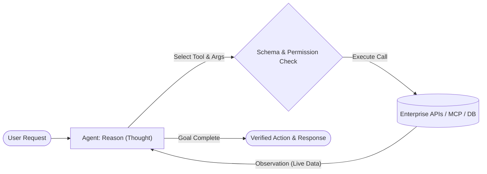

# 04. Tool Use & ReAct (Reason + Act)

[← Back to Playbook Overview](../README.md)

## a) What is this pattern?

Think of **Tool Use & ReAct** like a skilled detective with a smartphone and access to company databases. A person locked in an empty room can only guess answers from memory—and might make things up. Give that person a calculator, a live inventory terminal, and a CRM lookup tool, and they will **Reason** ("I need to check if this item is in stock"), **Act** (query the inventory system), **Observe** the real result ("Only 2 left in Chicago"), and decide the next step based on facts.

---

## b) Why this pattern?

### The Business Problem
Out of the box, AI models are frozen in time and disconnected from your business systems. They don't know today's account balance, live shipping status, or customer order history, and they are notoriously bad at mental arithmetic. Relying on raw AI memory leads to hallucinated numbers and an inability to actually *complete* transactions for users.

### Return on Investment (ROI)
- **Eliminates Data Hallucinations:** Grounding every answer in live system-of-record API calls (ERP, CRM, SQL, MCP servers) brings factual accuracy on operational data close to **100%**.
- **From Chatbots to Action-Takers:** Instead of telling a customer *how* to change their flight or process a return, the agent actually executes the API call (within authorized permissions), turning deflection into true self-service resolution.
- **Standardized Connectivity (MCP):** Using standardized tool protocols like the **Model Context Protocol (MCP)** lets you build a tool connector once and reuse it across multiple agents.

---

## c) When to use?

### Decision Checklist
- [x] The answer depends on **live, dynamic, or user-specific data** stored in databases, APIs, or external tools.
- [x] The agent needs to **perform real-world actions** (book an appointment, issue a credit, create a ticket, run a calculation).
- [x] The exact sequence of tool calls depends on what the first lookup returns (e.g., if out of stock in Warehouse A, check Warehouse B).
- [x] Every tool input and output can be validated with strict data schemas (**Read-Validate-Write-Verify**).
- [ ] *Avoid when:* The workflow is 100% static and always calls the exact same APIs in the exact same order (hardcode the API calls in a [01. Prompt Chaining](../01-prompt-chaining/) pipeline for lower latency and cost).

### High-Level Architecture

---

## d) Scorecard & Eval Pass/Fail

| Metric | Target Benchmark | Pass Criteria (Go-Live) | Fail Criteria (Block Release) |
|---|---|---|---|
| **Accuracy** | Tool selection & parameter accuracy | **≥ 98%** correct tool + valid schema parameters; **0** fabricated tool outputs | **< 95%** tool accuracy or agent guesses figures instead of calling the calculator/API |
| **Cost** | Tool calls & tokens per resolved task | **≤ 4 tool calls** average per task; hard loop breaker at **8 steps** | Runaway retry loops exceeding **10 tool calls** on a single user query |
| **Latency** | End-to-end tool loop response time (p95) | **≤ 4.5 seconds** (using parallel tool calling where independent) | **> 10.0 seconds** due to sequential tool calls that could have been batched |
| **Reliability / Business Value** | Idempotency & zero duplicate side-effects | **100%** of write actions use idempotency keys; **≥ 85%** end-to-end task completion | Duplicate orders/refunds triggered on retry or unauthorized API mutations |

---

## e) Use Cases

### 1. Retail: Autonomous Order Modification & Inventory Substitution
- **Scenario:** A customer asks to swap the size of a jacket in an order placed an hour ago. The agent reasons through the steps: (1) calls `get_order_status` to verify the package hasn't shipped, (2) calls `check_inventory` for the new size, (3) calls `update_order_line_item` to swap the SKU, and (4) sends a confirmation receipt.
- **Business Benefit:** Resolves post-purchase modifications 24/7 without human agent intervention and prevents costly return-and-reship cycles.
- **Primary KPI:** **Self-Service Resolution Rate** increased from 30% to **78%**, saving **\$4.50 per deflected support ticket**.

### 2. Banking: Interactive Commercial Treasury & Cash-Flow Assistant
- **Scenario:** A corporate treasurer asks, *"Can we cover Friday's €2M supplier payroll from our Frankfurt operating account without breaching our minimum liquidity buffer?"* The agent queries live account balances via API, fetches scheduled incoming receivables, runs a deterministic Python/calculator tool for exact currency conversion and buffer math, and presents a verified breakdown.
- **Business Benefit:** Replaces 45 minutes of spreadsheet exports and manual FX math with an instant, audit-logged answer.
- **Primary KPI:** **Treasury Decision Speed** improved by **90%** with **0 arithmetic or FX calculation errors**.

### 3. Healthcare: Automated Appointment Scheduling & Pre-Visit Prep
- **Scenario:** A patient needs a follow-up MRI and cardiology consult within the same afternoon. The agent checks prerequisite lab clearances in the EHR (`get_patient_orders`), queries available imaging and clinic slots (`search_schedule`), books coordinated back-to-back appointments (`book_slot`), and sends prep instructions (e.g., fasting rules).
- **Business Benefit:** Eliminates 15-minute phone hold times and reduces scheduling errors when coordinating multi-department visits.
- **Primary KPI:** **Patient No-Show Rate** reduced by **22%** and **Call Center Abandonment Rate** cut by **40%**.

---

## f) Foundational arXiv Papers & Further Reading

- **[ReAct: Synergizing Reasoning and Acting in Language Models (arXiv:2210.03629)](https://arxiv.org/abs/2210.03629)** — The seminal paper introducing interleaved `Thought → Action → Observation` loops to ground decisions in external tool lookups.
- **[Toolformer: Language Models Can Teach Themselves to Use Tools (arXiv:2302.04761)](https://arxiv.org/abs/2302.04761)** — Shows how language models learn when and how to call external APIs, calculators, and search engines.
- **[Gorilla: Large Language Model Connected with Massive APIs (arXiv:2305.15334)](https://arxiv.org/abs/2305.15334)** — Improves schema-accurate API function calling and reduces hallucinated tool arguments.
- **[ToolLLM: Facilitating Large Language Models to Master 16000+ Real-World APIs (arXiv:2307.16789)](https://arxiv.org/abs/2307.16789)** — Scales tool-use reasoning across thousands of enterprise REST APIs.
- **[Executable Code Actions Elicit Better LLM Agents (CodeAct, arXiv:2402.01030)](https://arxiv.org/abs/2402.01030)** — Uses executable Python code as a unified action space for composing multi-tool operations and exact math.
- **[Model Context Protocol (MCP) Specification](https://modelcontextprotocol.io)** — The open industry standard for connecting AI agents to enterprise data sources and tools.

