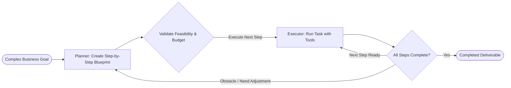

# 05. Planning (Plan-and-Execute)

[← Back to Playbook Overview](../README.md)

## a) What is this pattern?

Think of **Planning (Plan-and-Execute)** like an architect drafting a complete blueprint and project schedule before a single brick is laid. Instead of improvising step-by-step in the dark, the system first studies the goal, breaks it into an ordered checklist of milestones, validates that the plan makes sense, and then hands the individual tasks off to fast workers to execute—revising the blueprint only if an unexpected roadblock appears.

---

## b) Why this pattern?

### The Business Problem
When an agent tries to solve a long, 10-step business problem purely on the fly (like a basic ReAct loop), it often loses sight of the big picture by step 4. It gets distracted by minor errors, repeats work, or takes an inefficient path because it never mapped out dependencies up front.

### Return on Investment (ROI)
- **Higher Completion Rates on Complex Workflows:** Separating strategic planning from tactical execution boosts success rates on multi-step enterprise tasks by **30–50%**.
- **Smarter Model Spend:** You only pay for a top-tier reasoning model once at the beginning to create (and occasionally adjust) the blueprint, while smaller, cheaper models execute the individual steps.
- **Auditability & Preview:** Because the agent generates an explicit plan *before* taking action, users or automated rules can review and approve the plan before any changes are committed (**Draft-Preview-Approve-Commit**).

---

## c) When to use?

### Decision Checklist
- [x] The goal requires **5 or more coordinated steps** where later steps depend on earlier discoveries.
- [x] Different requests require **different custom action plans** that cannot be hardcoded into a static pipeline.
- [x] Stakeholders want visibility into **what the AI intends to do** (a visible checklist/progress tracker) before or during execution.
- [x] Obstacles mid-task require intelligent **re-planning** rather than failing the whole job.
- [ ] *Avoid when:* The task takes only 1–2 simple tool lookups (planning upfront adds unnecessary wait time and token overhead).

### High-Level Architecture

---

## d) Scorecard & Eval Pass/Fail

| Metric | Target Benchmark | Pass Criteria (Go-Live) | Fail Criteria (Block Release) |
|---|---|---|---|
| **Accuracy** | Plan validity & end-to-end goal completion | **≥ 90%** end-to-end completion on complex multi-step golden tasks; **100%** precondition compliance | Planner generates impossible steps, skips prerequisites, or completes **< 80%** of benchmark tasks |
| **Cost** | Planner + Executor total cost per project | **≤ \$0.15** per multi-step workflow; re-planning triggered on **≤ 20%** of steps | Constant re-planning after every single step, driving costs **> \$0.50** per run |
| **Latency** | Time to initial plan + total execution time | Initial blueprint visible to user in **≤ 3.0 seconds**; independent steps parallelized | User waits **> 15 seconds** with no plan preview or progress feedback |
| **Reliability / Business Value** | Recovery from mid-workflow tool failures | Successfully adapts plan and recovers from **≥ 85%** of recoverable dependency failures | Stalls in an infinite re-planning loop or leaves partial uncommitted changes on failure |

---

## e) Use Cases

### 1. Retail: Automated Supply Chain Disruption Recovery
- **Scenario:** A port strike delays a container of 5,000 holiday electronics items. Given the goal *"Minimize stockouts for VIP pre-orders within a \$15,000 expedite budget,"* the Planner creates a blueprint: (1) identify affected SKUs and VIP orders, (2) check excess stock across regional stores, (3) calculate air-freight vs. regional transfer costs from backup suppliers, (4) draft purchase/transfer orders for supply chain manager approval.
- **Business Benefit:** Turns a 2-day emergency war-room scramble into a structured, cost-optimized recovery plan in minutes.
- **Primary KPI:** **Out-of-Stock Revenue Loss** reduced by **35%** and **Incident Response Planning Time** cut from 16 hours to **15 minutes**.

### 2. Banking: Automated Regulatory Audit Evidence Preparation
- **Scenario:** An internal audit team requests evidence for 25 controls across access management, change logs, and wire approvals for Q3. The Planner decomposes the audit request into a dependency graph of data pulls across Jira, ServiceNow, Active Directory, and core banking logs, executes each query, flags missing sign-offs, and compiles an indexed audit binder.
- **Business Benefit:** Eliminates weeks of manual screenshot-gathering and spreadsheet tracking ahead of regulatory examinations.
- **Primary KPI:** **Audit Preparation Engineering Hours** reduced by **70%** and **Audit Finding Remediation Cycle Time** cut by **50%**.

### 3. Healthcare: Complex Care-Gap Closure & Outreach Campaign
- **Scenario:** A health system wants to close overdue diabetic eye exams and A1C lab gaps for 1,200 high-risk patients. The Planner maps out a patient-by-patient action plan: verify active insurance coverage, check existing upcoming appointments to bundle lab orders, schedule mobile clinic slots for transportation-challenged patients, and queue personalized multilingual outreach.
- **Business Benefit:** Coordinates clinical, scheduling, and outreach steps holistically rather than bombarding patients with disconnected robo-calls.
- **Primary KPI:** **HEDIS Care-Gap Closure Rate** improved by **28%** and **Quality Bonus Reimbursement** increased by **\$1.2M annually**.

---

## f) Foundational arXiv Papers & Further Reading

- **[Plan-and-Solve Prompting: Improving Zero-Shot Chain-of-Thought Reasoning by Large Language Models (arXiv:2305.04091)](https://arxiv.org/abs/2305.04091)** — Devises an explicit upfront plan before solving complex multi-step problems to prevent missing intermediate steps.
- **[ReWOO: Decoupling Reasoning from Observations for Efficient Augmented Language Models (arXiv:2305.18323)](https://arxiv.org/abs/2305.18323)** — Separates upfront symbolic blueprint generation from tool execution, reducing token consumption by 5x.
- **[LLM+P: Empowering Large Language Models with Optimal Planning Proficiency (arXiv:2304.11477)](https://arxiv.org/abs/2304.11477)** — Combines LLMs with classical symbolic planners for guaranteed valid execution plans.
- **[LLMs Can't Plan, But Can Help Planning in LLM-Modulo Frameworks (arXiv:2402.01817)](https://arxiv.org/abs/2402.01817)** — Pairs LLM plan generation with external deterministic verifiers and critics to guarantee precondition/postcondition safety.
- **[Do As I Can, Not As I Say: Grounding Language in Robotic Affordances (SayCan, arXiv:2204.01691)](https://arxiv.org/abs/2204.01691)** — Grounds high-level plans in real-world feasibility checks before executing actions.

