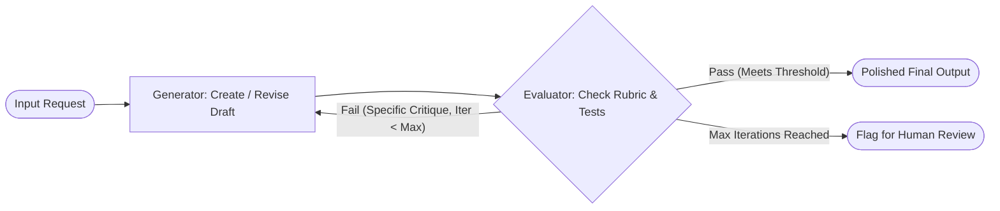

# 06. Reflection & Evaluator-Optimizer

[← Back to Playbook Overview](../README.md)

## a) What is this pattern?

Think of **Reflection & Evaluator-Optimizer** like a writer working with a tough, detail-oriented chief editor. The writer produces a first draft, and the editor grades it against a strict quality checklist—marking up missing facts, awkward phrasing, or policy violations. The writer then revises the draft based on that exact feedback until the editor signs off (or a maximum revision limit is reached).

---

## b) Why this pattern?

### The Business Problem
Just like humans, AI rarely does its best work on the very first rough draft—especially when balancing multiple constraints like legal compliance, factual citations, brand tone, and formatting. Shipping first-draft AI outputs directly to customers or executives leads to embarrassing errors and erodes trust.

### Return on Investment (ROI)
- **Near-Expert Quality Without Human Bottlenecks:** Automated critique-and-revise loops catch **70–90% of first-draft errors** before a human ever has to review the output.
- **Objective Rubric Enforcement:** Using a separate Evaluator prompt (or deterministic test runner like a code compiler) prevents the generator from grading its own homework leniently.
- **Predictable Cost Cap:** By limiting the loop to 2–3 revisions maximum, you capture almost all the quality gains while keeping token spend strictly bounded.

---

## c) When to use?

### Decision Checklist
- [x] Output quality is noticeably better when given a chance to **review and revise against a clear rubric**.
- [x] You have **objective evaluation criteria** (e.g., code passes unit tests, SQL query executes cleanly, summary cites every claim, tone matches brand rubric).
- [x] High quality is more important than instant sub-second speed (users can wait a few extra seconds for a polished deliverable).
- [x] You want to reduce the manual editing burden on expensive human experts (lawyers, doctors, senior engineers).
- [ ] *Avoid when:* You don't have a clear definition of what "good" looks like—if the evaluator's rubric is vague, revisions will just spin in circles without improving quality.

### High-Level Architecture

---

## d) Scorecard & Eval Pass/Fail

| Metric | Target Benchmark | Pass Criteria (Go-Live) | Fail Criteria (Block Release) |
|---|---|---|---|
| **Accuracy** | Quality lift from Draft 1 to Final Output | **≥ +20%** rubric pass rate improvement over Draft 1; **≥ 96%** final compliance | Revision loop introduces new hallucinations or degrades Draft 1 accuracy |
| **Cost** | Average iterations per task | Mean **≤ 1.8 iterations**; hard cap at **3 iterations** maximum | **> 30%** of tasks hitting max iterations without passing evaluator rubric |
| **Latency** | Multi-turn critique & revision time (p95) | **≤ 8.0 seconds** total across generation + evaluation + 1 revision | **> 15.0 seconds** for interactive tasks or unbounded revision loops |
| **Reliability / Business Value** | Reduction in human editing time | **≥ 75%** of outputs accepted by human reviewers with zero manual edits | Evaluator passes flawed outputs (false accepts **> 3%**) |

---

## e) Use Cases

### 1. Retail: Personalized Marketing Copy & Legal Promotional Compliance
- **Scenario:** A merchandising agent drafts personalized promotional emails for a loyalty tier. The Evaluator checks the draft against three strict rules: (1) discount math matches the promo engine exactly, (2) mandatory sweepstakes/exclusion legal disclaimers are included, and (3) tone is warm and non-spammy. If any check fails, the Generator revises the email before queuing it for send.
- **Business Benefit:** Prevents costly promo-code margin leaks and regulatory fines while scaling personalized marketing.
- **Primary KPI:** **Marketing QA Review Time** reduced by **80%** and **Promotional Pricing Errors** reduced to **0%**.

### 2. Banking: Automated SQL/Python Analytics & Financial Report Generation
- **Scenario:** A wealth advisor asks an internal analytics agent for a custom client portfolio attribution report. The Generator writes the SQL query and narrative summary; the Evaluator executes the SQL in a read-only sandbox, verifies that portfolio weights sum to 100.0%, and checks that performance disclosures match FINRA guidelines—auto-fixing syntax or rounding mismatches before displaying the chart.
- **Business Benefit:** Delivers self-service analytics to advisors without risking broken queries or non-compliant client reports.
- **Primary KPI:** **First-Time Query & Report Success Rate** boosted from 68% to **97%**, saving **4 hours per advisor per week**.

### 3. Healthcare: Clinical Appeal Letter Generation for Denied Claims
- **Scenario:** When an insurer denies a medically necessary procedure, the Generator drafts a clinical appeal letter citing the patient's EHR history and peer-reviewed guidelines. The Evaluator critiques the draft against the insurer's specific denial reason code, verifies every clinical date and lab value against the patient chart, and demands revisions if any argument lacks direct evidence.
- **Business Benefit:** Produces airtight, evidence-backed clinical appeals in minutes instead of hours of physician writing time.
- **Primary KPI:** **Claim Denial Overturn Rate** increased from 52% to **79%**, recovering **\$3.5M+ in annual hospital revenue**.

---

## f) Foundational arXiv Papers & Further Reading

- **[Self-Refine: Iterative Refinement with Self-Feedback (arXiv:2303.17651)](https://arxiv.org/abs/2303.17651)** — Introduces the core Generate → Critique → Refine loop, improving task performance by ~20% across diverse benchmarks.
- **[Reflexion: Language Agents with Verbal Reinforcement Learning (arXiv:2303.11366)](https://arxiv.org/abs/2303.11366)** — Converts execution failures and evaluator feedback into persistent verbal lessons stored in memory for subsequent attempts.
- **[CRITIC: Large Language Models Can Self-Correct with Tool-Interactive Critiquing (arXiv:2305.11738)](https://arxiv.org/abs/2305.11738)** — Proves that verification is dramatically more reliable when the Evaluator uses external tools (compilers, calculators, search) rather than pure self-reflection.
- **[Teaching Large Language Models to Self-Debug (arXiv:2304.05128)](https://arxiv.org/abs/2304.05128)** — Uses unit test and compiler execution feedback to iteratively repair generated code and SQL.
- **[Scaling LLM Test-Time Compute Optimally can be More Effective than Scaling Model Parameters (arXiv:2408.03314)](https://arxiv.org/abs/2408.03314)** — Shows how allocating inference-time verification and revision budgets outperforms simply using a larger single-pass model.
- **[DeepSeek-R1: Incentivizing Reasoning Capability in LLMs via Reinforcement Learning (arXiv:2501.12948)](https://arxiv.org/abs/2501.12948)** & **[s1: Simple Test-Time Scaling (arXiv:2501.19393)](https://arxiv.org/abs/2501.19393)** — Demonstrate built-in self-verification and test-time compute scaling in modern reasoning models.

