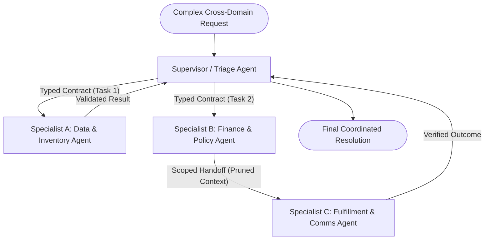

# 07. Multi-Agent Orchestrator & Scoped Handoffs

[← Back to Playbook Overview](../README.md)

## a) What is this pattern?

Think of **Multi-Agent Orchestrator & Scoped Handoffs** like a general contractor managing a home renovation—or an air traffic controller handing off a flight from tower to tower. A single worker cannot be a master electrician, licensed plumber, and structural engineer all at once without making mistakes. Instead, a **Supervisor** coordinates specialized agents using strict work orders (**Typed Contracts**), or one specialist cleanly transfers active control and a concise briefing packet to the next specialist (**Scoped Handoff**).

---

## b) Why this pattern?

### The Business Problem
When a single AI agent is given 40+ tools and instructions spanning five different departments, its context window gets polluted. It confuses similar-looking tools, leaks irrelevant conversation history, and becomes impossible for separate engineering teams to maintain independently.

### Return on Investment (ROI)
- **Higher Accuracy Across Deep Domains:** Keeping each specialist agent restricted to 5–8 domain tools and focused instructions boosts tool selection accuracy by **25–40%** compared to a monolithic agent.
- **Modular Team Ownership:** The Payments team can build, test, and update the Billing Agent while the Logistics team owns the Shipping Agent, connected via strict data contracts.
- **Token Savings via Scoped Handoffs:** Passing only a pruned, validated summary packet between specialists avoids paying to re-read thousands of words of raw scratchpad history at every step.

---

## c) When to use?

### Decision Checklist
- [x] A single agent's accuracy drops because it has **too many tools (> 15–20)** or conflicting domain instructions.
- [x] Different sub-tasks require **distinct security permissions, data access boundaries, or model capabilities**.
- [x] You have measured a single-agent baseline and proved on your **Evaluation Scorecard** that specialization improves outcomes.
- [x] Every agent-to-agent interaction uses **typed, schema-validated contracts** or clean handoffs (avoid unstructured group chat).
- [ ] *Avoid when:* A single agent with clean tools or a deterministic workflow can solve the problem—multi-agent systems add coordination cost and failure modes ([MAST, arXiv:2503.13657](https://arxiv.org/abs/2503.13657)).

### High-Level Architecture

---

## d) Scorecard & Eval Pass/Fail

| Metric | Target Benchmark | Pass Criteria (Go-Live) | Fail Criteria (Block Release) |
|---|---|---|---|
| **Accuracy** | Measurable lift over single-agent baseline | **≥ +10%** task completion improvement over single-agent baseline; **100%** contract schema validity | Performs equal to or worse than a single agent, or agents drop context during handoffs |
| **Cost** | Multi-agent coordination overhead (`O(n)` to `O(n²)`) | Total token spend **≤ 2.5x** single-agent baseline with hard per-agent step & budget caps | Chatty agent-to-agent loops driving **> 4x** cost spikes |
| **Latency** | Handoff & orchestration latency (p95) | **≤ 8.0 seconds** for 2-specialist handoff; parallel delegation used where independent | Nested middleman relays adding **> 5 seconds** of pure routing overhead |
| **Reliability / Business Value** | Loop prevention & audit trace clarity | **0** circular handoff loops (max depth enforced); every specialist action tied to a trace ID | Agents bounce a customer back and forth endlessly ("ping-pong" failure mode) |

---

## e) Use Cases

### 1. Retail: End-to-End Post-Purchase Resolution & Warranty Replacement
- **Scenario:** A customer reports a defective espresso machine under warranty. The **Triage Agent** collects the serial number and hands off a validated ticket to the **Diagnostics Specialist Agent** (which walks through troubleshooting). When confirmed defective, control transfers via a **Scoped Handoff** to the **RMA & Logistics Specialist Agent** (scoped only to warehouse replacement and prepaid return label tools).
- **Business Benefit:** Gives each stage deep domain expertise and strict tool permissions without overwhelming a single prompt.
- **Primary KPI:** **Complex Warranty Resolution Rate** increased by **38%** and **Incorrect Replacement Shipments** reduced by **50%**.

### 2. Banking: End-to-End Small Business (SMB) Account & Credit Onboarding
- **Scenario:** An SMB applies for a commercial checking account and credit line. A **Supervisor Orchestrator** delegates typed tasks to three specialists: (1) **KYC/KYB Specialist Agent** (verifies business registry and beneficial ownership), (2) **Cash-Flow Underwriting Agent** (analyzes bank statements and tax returns), and (3) **Account Provisioning Agent** (generates disclosures and configures account limits).
- **Business Benefit:** Enforces strict regulatory separation of duties between identity verification, credit underwriting, and account creation.
- **Primary KPI:** **SMB Onboarding Time-to-Funding** reduced from 7 business days to **under 2 hours**.

### 3. Healthcare: Multidisciplinary Oncology Tumor Board Preparation
- **Scenario:** Ahead of a weekly oncology conference, a **Supervisor Agent** coordinates three specialist agents: (1) **Pathology & Genomics Agent** (synthesizes biopsy and biomarker mutations), (2) **Radiology Timeline Agent** (tracks tumor size progression across serial CT/MRI reports), and (3) **Clinical Trial Matching Agent** (matches patient biomarkers and staging against active NCI/institutional trials).
- **Business Benefit:** Presents the clinical team with a unified, cross-checked case packet and eligible clinical trials before they enter the room.
- **Primary KPI:** **Clinical Trial Screening Throughput** increased by **4x** and **Physician Case Prep Time** reduced by **60%**.

---

## f) Foundational arXiv Papers & Further Reading

- **[AutoGen: Enabling Next-Gen LLM Applications via Multi-Agent Conversation (arXiv:2308.08155)](https://arxiv.org/abs/2308.08155)** — Foundational framework for orchestrating customizable, conversing specialist agents and tool executors.
- **[Magentic-One: A Generalist Multi-Agent System for Solving Complex Tasks (arXiv:2411.04468)](https://arxiv.org/abs/2411.04468)** — Introduces a dual-ledger Supervisor Orchestrator (Task Ledger + Progress Ledger) coordinating specialized web, file, and code agents.
- **[MetaGPT: Meta Programming for A Multi-Agent Collaborative Framework (arXiv:2308.00352)](https://arxiv.org/abs/2308.00352)** — Encodes Standardized Operating Procedures (SOPs) and typed structured outputs between agents to prevent cascading hallucinations.
- **[Improving Factuality and Reasoning in Language Models through Multiagent Debate (arXiv:2305.14325)](https://arxiv.org/abs/2305.14325)** — Shows how multiple independent agents critiquing each other's reasoning reduces factual errors on high-stakes decisions.
- **[Why Do Multi-Agent LLM Systems Fail? (MAST, arXiv:2503.13657)](https://arxiv.org/abs/2503.13657)** — Essential taxonomy of multi-agent failure modes (specification drift, inter-agent misalignment, and verification gaps) and how typed contracts mitigate them.
- **[A2A Protocol Specification](https://a2a-protocol.org)** & **[OpenAI Agents SDK (Handoffs)](https://openai.github.io/openai-agents-python/)** — Industry standards for typed agent-to-agent interoperability and scoped control transfer.

