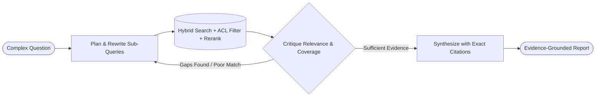

# 08. Agentic RAG & Deep Research

[← Back to Playbook Overview](../README.md)

## a) What is this pattern?

Think of **Agentic RAG & Deep Research** like the difference between a basic office search bar and a seasoned investigative journalist. A basic search bar just grabs the top 3 documents that match your keywords—even if they are outdated, incomplete, or irrelevant. An investigative journalist breaks the question into angles, searches multiple sources, reads the results critically, realizes what is missing, follows citations across documents, and compiles a fact-checked, footnoted report.

---

## b) Why this pattern?

### The Business Problem
Standard "naive RAG" (Retrieval-Augmented Generation) fails on complex enterprise questions. If a user asks a multi-part question or uses slightly different terminology than the policy manual, basic vector search pulls the wrong paragraphs, and the AI either says *"I don't know"* or confidently hallucinates an answer from bad context.

### Return on Investment (ROI)
- **Drastic Reduction in Retrieval Failures:** Combining **Contextual Retrieval** (adding document context before indexing), **Hybrid Search + Reranking**, and **Self-Correction (Corrective RAG)** cuts missed or wrong answers by **50–70%**.
- **Weeks of Research in Minutes (Deep Research):** Iterative **Scope → Plan → Search → Critique → Synthesize** loops automate comprehensive market, legal, and scientific research that previously took analysts days.
- **Zero-Trust Security & Provenance:** Enforcing user access permissions (ACLs) at retrieval time ensures an employee only sees answers drawn from documents they are authorized to read, with clickable citations for every claim.

---

## c) When to use?

### Decision Checklist
- [x] Answers must be **100% grounded in proprietary company documents, policies, or live web data** with verifiable citations.
- [x] Questions are **multi-hop or comparative** (e.g., *"Compare our Q3 supplier terms in Germany vs. Japan and flag compliance gaps"*).
- [x] Single-shot keyword or vector search frequently misses relevant context or retrieves noisy chunks.
- [x] Strict **document-level access control (ACLs)** and data freshness guarantees are mandatory.
- [ ] *Avoid when:* All required information is already passed directly in the user's input (e.g., summarizing a single short email).

### High-Level Architecture

---

## d) Scorecard & Eval Pass/Fail

| Metric | Target Benchmark | Pass Criteria (Go-Live) | Fail Criteria (Block Release) |
|---|---|---|---|
| **Accuracy** | Citation faithfulness & answer completeness | **≥ 98%** of claims directly supported by cited source chunks; **0** ACL permission leaks | **> 2%** unsupported/hallucinated claims or any document retrieved outside caller's ACL scope |
| **Cost** | Search iterations & reranking cost per query | **≤ \$0.05** for standard Agentic RAG; **≤ \$0.50** for long-horizon Deep Research reports | Unbounded re-query loops when information genuinely does not exist in the corpus |
| **Latency** | Retrieval + critique + synthesis latency (p95) | **≤ 3.5 seconds** for interactive Agentic RAG; **≤ 90 seconds** for Deep Research briefs | **> 8.0 seconds** on simple single-hop lookup queries |
| **Reliability / Business Value** | Abstention accuracy ("Stop-When-Sufficient") | Cleanly states what is missing when corpus lacks evidence (**≥ 95%** abstention precision) | Guesses an answer from pre-training memory when internal policy docs are silent |

---

## e) Use Cases

### 1. Retail: Global Supplier Compliance & Ethical Sourcing Deep Research
- **Scenario:** Before signing a new apparel manufacturer, procurement asks an Agentic Deep Research system to investigate the supplier. The agent searches internal audit archives, global customs records, ESG databases, and local-language news, cross-referencing subsidiary ownership graphs (GraphRAG) to surface any sub-tier labor or environmental violations with exact source links.
- **Business Benefit:** Uncovers hidden multi-tier supply chain risks that manual keyword searches miss.
- **Primary KPI:** **Supplier Vetting Research Time** reduced from 40 hours to **20 minutes**, with **3x higher detection of sub-tier risk signals**.

### 2. Banking: Cross-Jurisdictional Regulatory & Policy Interpretation
- **Scenario:** A compliance officer asks how a new Basel III or DORA rule change impacts existing derivatives onboarding procedures across UK, EU, and US desks. The Agentic RAG system rewrites the query per jurisdiction, retrieves exact regulatory clauses and internal bank SOPs (enforcing desk-level ACLs), verifies whether retrieved policies are current or superseded, and outputs a side-by-side gap matrix.
- **Business Benefit:** Eliminates the risk of acting on outdated policy versions and accelerates regulatory change management.
- **Primary KPI:** **Policy Gap Analysis Cycle Time** reduced by **75%** with **100% clause-level citation traceability**.

### 3. Healthcare: Point-of-Care Clinical Guideline & Drug-Interaction Synthesis
- **Scenario:** A physician treating a complex patient with renal impairment and three comorbidities asks how to adjust a specialty oncology regimen. The Agentic RAG system retrieves latest FDA package inserts, NCCN clinical guidelines, and institutional pharmacy protocols, critiques whether the evidence applies to the patient's specific eGFR lab range, and presents a cited dosing summary.
- **Business Benefit:** Gives clinicians instant, citation-verified evidence at the bedside without digging through hundreds of pages of PDFs.
- **Primary KPI:** **Time to Clinical Evidence Lookup** cut from 20 minutes to **15 seconds** and **Adverse Drug Event (ADE) Rate** reduced by **18%**.

---

## f) Foundational arXiv Papers & Further Reading

- **[Retrieval-Augmented Generation for Knowledge-Intensive NLP Tasks (arXiv:2005.11401)](https://arxiv.org/abs/2005.11401)** — The original RAG paper grounding language generation in retrieved external documents.
- **[Self-RAG: Learning to Retrieve, Generate, and Critique through Self-Reflection (arXiv:2310.11511)](https://arxiv.org/abs/2310.11511)** — Trains models to adaptively decide when to retrieve and critique whether retrieved passages actually support the response.
- **[Corrective Retrieval Augmented Generation (CRAG, arXiv:2401.15884)](https://arxiv.org/abs/2401.15884)** — Uses a lightweight retrieval evaluator to score document relevance and trigger query rewriting or web fallback when retrieval quality is low.
- **[From Local to Global: A Graph RAG Approach to Query-Focused Summarization (GraphRAG, arXiv:2404.16130)](https://arxiv.org/abs/2404.16130)** & **[LightRAG: Simple and Fast Retrieval-Augmented Generation (arXiv:2410.05779)](https://arxiv.org/abs/2410.05779)** — Use entity knowledge graphs and dual-level retrieval to answer multi-hop and global sensemaking queries across large corpora.
- **[Agentic Retrieval-Augmented Generation: A Survey on Agentic RAG (arXiv:2501.09136)](https://arxiv.org/abs/2501.09136)** — Comprehensive taxonomy of autonomous query planning, multi-step retrieval, and self-critique workflows.
- **[BrowseComp: A Simple Yet Challenging Benchmark for Browsing Agents (arXiv:2504.12516)](https://arxiv.org/abs/2504.12516)** — Evaluates persistent, multi-hop Deep Research agents navigating complex information landscapes.

