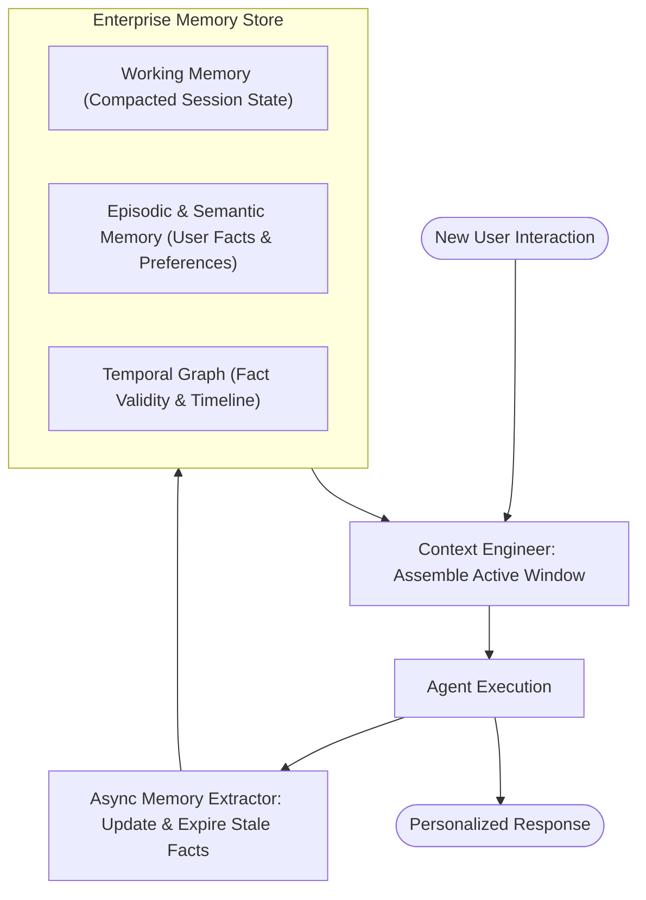

# 09. Memory & Context Engineering

[← Back to Playbook Overview](../README.md)

## a) What is this pattern?

Think of **Memory & Context Engineering** like a concierge doctor's patient chart combined with a tidy desk. If a doctor kept every single word ever spoken by every patient in a giant pile of paper on their desk, they wouldn't be able to find anything—and would miss critical allergies buried on page 400. Instead, they keep a **clean working desk** for today's visit (**Working Memory**), a structured summary of active conditions and preferences (**Semantic/Episodic Memory**), and a timeline that crosses out old medications when new ones are prescribed (**Temporal Graph Memory**).

---

## b) Why this pattern?

### The Business Problem
AI models suffer from two opposite memory problems: either they have **amnesia** (forgetting who the customer is the moment a chat window closes) or **context bloat** (stuffing entire raw chat histories into the prompt until the AI gets confused—the *"Lost in the Middle"* effect—while token costs skyrocket).

### Return on Investment (ROI)
- **80–90% Lower Token Costs on Long Sessions:** Compacting old turns and retrieving only relevant extracted facts (`Mem0`, `Zep/Graphiti`, `Letta`) slashes prompt token consumption across multi-session journeys.
- **Higher Accuracy on Changing Facts:** Temporal knowledge graphs track *when* a fact changed (e.g., *"Customer moved from New York to Austin in June"*), preventing the agent from acting on stale information.
- **True Long-Term Personalization:** Customers and employees never have to repeat their preferences, past troubleshooting steps, or project context across sessions.

---

## c) When to use?

### Decision Checklist
- [x] Users interact with the agent **across multiple sessions, days, or channels** and expect continuity.
- [x] Single tasks run for many steps, generating large tool outputs that must be **compacted or offloaded** to prevent context window overflow.
- [x] User facts and business states **change over time**, requiring old facts to be invalidated rather than duplicated.
- [x] Proven workflows can be saved as reusable procedures (**Skill Library**) so the agent doesn't reinvent the wheel next time.
- [ ] *Avoid when:* Every transaction is strictly stateless, anonymous, or prohibited by privacy regulations from storing persistent user profiles.

### High-Level Architecture

---

## d) Scorecard & Eval Pass/Fail

| Metric | Target Benchmark | Pass Criteria (Go-Live) | Fail Criteria (Block Release) |
|---|---|---|---|
| **Accuracy** | Long-range fact recall & temporal update accuracy | **≥ 95%** recall on multi-session facts; **≥ 98%** accuracy when a newer fact supersedes an older fact | Agent acts on outdated/contradicted facts or hallucinates memories across users |
| **Cost** | Token reduction vs. full-history baseline | **≥ 75% token reduction** on 20+ turn conversations via compaction and selective retrieval | Context grows linearly without compaction until hitting model token ceiling |
| **Latency** | Memory retrieval & context assembly overhead (p95) | **≤ 150 ms** for memory read; memory consolidation runs **asynchronously** out-of-band | Synchronous memory extraction blocking user response by **> 2.0 seconds** |
| **Reliability / Business Value** | Tenant isolation & GDPR/CCPA right-to-be-forgotten | **100%** cryptographic tenant/user isolation; **1-click hard deletion** of user memory graph | Any cross-user memory bleed or inability to purge specific PII records |

---

## e) Use Cases

### 1. Retail: Cross-Session Clienteling & Personal Stylist Agent
- **Scenario:** A shopper chats with a retail stylist agent over several months. The agent maintains a Temporal & Semantic Memory profile: sizing per brand, fabric allergies (no wool), upcoming life events (attending a summer wedding in Italy in July—automatically expired in August), and past returns ("returned brand X jeans for being too tight").
- **Business Benefit:** Delivers luxury in-store personal shopper continuity across web and mobile apps without asking repetitive sizing questions.
- **Primary KPI:** **Repeat Purchase Conversion Rate** increased by **32%** and **Size-Related Return Rate** reduced by **24%**.

### 2. Banking: Relationship Manager Institutional Memory & Client Advisory
- **Scenario:** Ahead of a quarterly review with a high-net-worth client, the advisory agent synthesizes episodic memories across past meetings, emails, and life milestones (e.g., *"Client sold business in Q1, prefers municipal bonds for tax efficiency, daughter starting college in 2027, rejected high-volatility tech funds in March"*).
- **Business Benefit:** Ensures seamless continuity even if a relationship manager changes roles, protecting high-value client relationships.
- **Primary KPI:** **Client Retention Rate** improved by **15%** and **Advisor Meeting Prep Time** reduced from 90 minutes to **5 minutes**.

### 3. Healthcare: Longitudinal Chronic Care Coaching & Symptom Tracking
- **Scenario:** A congestive heart failure (CHF) patient interacts daily with a care-management agent via SMS/voice. The memory layer tracks baseline weight trends, medication adherence obstacles, and temporal symptom updates (*"Swelling in ankles started Tuesday, resolved Friday after diuretic adjustment"*), compacting daily logs into a structured clinical timeline for the care nurse.
- **Business Benefit:** Detects multi-day clinical deterioration trends early while keeping the nurse's dashboard concise and actionable.
- **Primary KPI:** **Early Decompensation Detection Lead Time** improved by **4.5 days** and **Emergency Department Visits** reduced by **26%**.

---

## f) Foundational arXiv Papers & Further Reading

- **[MemGPT: Towards LLMs as Operating Systems (arXiv:2310.08560)](https://arxiv.org/abs/2310.08560)** — Introduces OS-inspired virtual context management, paging information between active working memory (RAM) and external archival storage (disk).
- **[Zep: A Temporal Knowledge Graph Architecture for Agent Memory (arXiv:2501.13956)](https://arxiv.org/abs/2501.13956)** — Tracks temporal validity windows on extracted facts so outdated user/business information is automatically invalidated when facts change.
- **[Mem0: Building Production-Ready AI Agents with Scalable Long-Term Memory (arXiv:2504.19413)](https://arxiv.org/abs/2504.19413)** — Demonstrates dynamic fact extraction, consolidation, and graph memory that cuts token costs by 80%+ over full-context baselines.
- **[Lost in the Middle: How Language Models Use Long Contexts (arXiv:2307.03172)](https://arxiv.org/abs/2307.03172)** — Proves that stuffing raw transcripts into massive context windows degrades recall on middle information, motivating active Context Engineering.
- **[Generative Agents: Interactive Simulacra of Human Behavior (arXiv:2304.03442)](https://arxiv.org/abs/2304.03442)** — Pioneers episodic memory streams scored by recency, importance, and relevance alongside periodic reflection synthesis.
- **[Voyager: An Open-Ended Embodied Agent with Large Language Models (arXiv:2305.16291)](https://arxiv.org/abs/2305.16291)** — Introduces an ever-growing **Skill Library** of verified, reusable procedures retrieved across future tasks.

