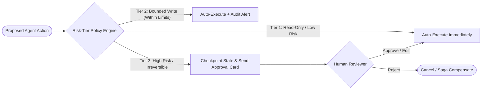

# 10. Human-in-the-Loop & Risk-Tiered Governance

[← Back to Playbook Overview](../README.md)

## a) What is this pattern?

Think of **Human-in-the-Loop (HITL) & Risk-Tiered Governance** like corporate expense approval limits in a well-run company. An employee can view a catalog freely (**Low Risk: Read-Only**), order \$25 of office supplies automatically (**Medium Risk: Bounded Write**), but needs a VP's digital signature before wiring \$50,000 or signing a legal contract (**High Risk: Irreversible / High Spend**). In AI, the system runs at full speed on safe tasks and automatically pauses to ask for a 1-click human sign-off before executing high-stakes actions.

---

## b) Why this pattern?

### The Business Problem
Fear of a rogue AI deleting a production database, issuing a \$100,000 refund, or sending an unapproved legal commitment keeps many enterprise AI projects stuck in eternal pilot purgatory. Conversely, requiring a human to approve every trivial lookup destroys the productivity gains of automation.

### Return on Investment (ROI)
- **Unlocks Production Deployment for High-Value Workflows:** Risk-tiered autonomy lets you automate **85–95% of routine volume** straight through while giving risk, legal, and security teams a 100% guarantee on high-exposure actions.
- **10x Faster Human Decisions:** When the agent escalates, it doesn't hand over a blank ticket—it prepares a complete **Draft-Preview-Approve** package with all evidence pre-gathered, turning a 20-minute investigation into a 15-second review.
- **Regulatory & Audit Compliance:** Every approval, rejection, and override is logged in an immutable audit trail with user identity and timestamp.

---

## c) When to use?

### Decision Checklist
- [x] The agent has tools that trigger **irreversible, financial, legal, clinical, or external-facing side effects** (e.g., wiring money, deleting records, modifying prescriptions).
- [x] Industry regulations (SOX, HIPAA, GDPR, EU AI Act, SR 11-7) mandate human accountability on consequential decisions.
- [x] Model confidence falls below a safe threshold, or a request falls into a grey area between policies.
- [x] You want to build organizational trust gradually—starting with human approval on writes and relaxing thresholds as scorecard metrics prove reliability.
- [ ] *Avoid when:* Actions are 100% read-only and low-risk (pausing for human approval to read a public FAQ just frustrates users).

### High-Level Architecture

---

## d) Scorecard & Eval Pass/Fail

| Metric | Target Benchmark | Pass Criteria (Go-Live) | Fail Criteria (Block Release) |
|---|---|---|---|
| **Accuracy** | Risk-tier classification & policy enforcement | **100%** of Tier-3 (high-risk) actions gated deterministically outside the prompt | Even **1** high-risk write action bypassing the approval gate in red-team tests |
| **Cost** | Human review rate vs. straight-through rate | **≤ 10–15%** of total volume escalated to humans; **≥ 85%** straight-through processing | **> 40%** escalation rate (creating human approval fatigue and rubber-stamping) |
| **Latency** | State checkpoint & resume speed | **≤ 200 ms** to pause/checkpoint state and resume instantly upon human click | Lost context when a human approves an action hours later (session timeout failure) |
| **Reliability / Business Value** | Approval package completeness & auditability | **100%** of escalations include full diff preview, citations, and 1-click rollback/compensation | Unlogged approvals or partial side-effects left behind after a human rejection |

---

## e) Use Cases

### 1. Retail: Tiered Refund, Chargeback & Markdown Governance
- **Scenario:** A customer support and merchandising agent handles refunds and price adjustments. Tier 1 (order lookup) and Tier 2 (refunds under \$75 for customers with high trust scores) execute instantly. Tier 3 (refunds over \$75, repeat-return accounts, or sitewide promotional markdowns > 20%) pauses and sends a Slack/Teams approval card to a supervisor with the order history, photo evidence, and a 1-click **Approve / Modify / Deny** button.
- **Business Benefit:** Delivers instant refunds to 90% of honest shoppers while completely blocking return-fraud rings and catastrophic pricing typos.
- **Primary KPI:** **Return Fraud & Margin Leakage** reduced by **45%** while keeping **Median Refund Resolution Time under 30 seconds**.

### 2. Banking: Commercial Wire Release & AML SAR Filing Approval
- **Scenario:** An AML financial crime investigator agent detects a suspicious transaction network. It automatically gathers KYC records, counterparty graphs, and transaction logs (Tier 1), places a temporary protective hold within policy limits (Tier 2), and drafts a complete FinCEN Suspicious Activity Report (SAR) narrative. Because filing a SAR or permanently freezing an account is a Tier 3 regulatory action, the agent pauses and routes the pre-filled dossier to a licensed BSA Officer for review and e-signature.
- **Business Benefit:** Automates 90% of the forensic legwork while maintaining strict regulatory human sign-off requirements.
- **Primary KPI:** **AML Alert Investigation Time** reduced from 3.5 hours to **12 minutes** with **100% regulatory audit compliance**.

### 3. Healthcare: Physician Co-Signature for Medication Orders & Prior Auth Submissions
- **Scenario:** An ambient clinical copilot listens to a patient-doctor visit, drafts the SOAP note, prepares lab orders, and stages a prescription adjustment in the EHR queue. Read-only chart prep executes automatically, but the prescription and billing codes remain in a staged **"Draft-Preview"** state until the attending physician reviews the highlighted summary and taps **"Sign & Commit"** on their tablet.
- **Business Benefit:** Eliminates after-hours "pajama time" EHR data entry while ensuring a licensed physician authorizes every clinical order.
- **Primary KPI:** **Physician EHR Clicking/Typing Time** cut by **55%** with **0 unauthorized clinical orders**.

---

## f) Foundational arXiv Papers & Further Reading

- **[Constitutional AI: Harmlessness from AI Feedback (arXiv:2212.08073)](https://arxiv.org/abs/2212.08073)** — Establishes explicit principle-based governance and alignment controls for autonomous model behavior.
- **[AgentDojo: A Dynamic Environment to Evaluate Prompt Injection Attacks and Defenses for LLM Agents (arXiv:2406.13352)](https://arxiv.org/abs/2406.13352)** — Demonstrates why risk-tiered autonomy (separating read actions from privileged write/spend actions) is essential for agent safety.
- **[τ-bench: A Benchmark for Tool-Agent-User Interaction in Real-World Domains (arXiv:2406.12045)](https://arxiv.org/abs/2406.12045)** — Evaluates how reliably agents follow domain policies and seek explicit user confirmation before executing state-changing actions in retail and airline workflows.
- **[Practices for Governing Agentic AI Systems (OpenAI Governance Whitepaper)](https://cdn.openai.com/papers/practices-for-governing-agentic-ai-systems.pdf)** — Industry framework for risk-tiered autonomy, action approval gates, traceability, and emergency stop controls.

