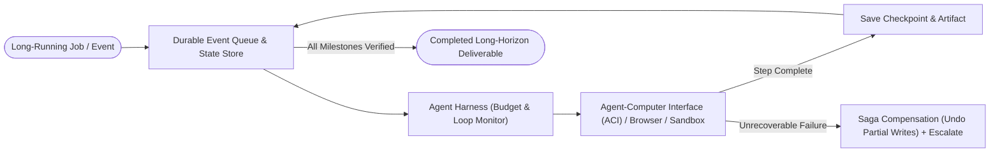

# 12. Durable Execution, Computer Use & Autonomous Harnesses

[← Back to Playbook Overview](../README.md)

## a) What is this pattern?

Think of **Durable Execution, Computer Use & Autonomous Harnesses** like a cross-country freight train equipped with GPS checkpoints, an automatic braking system, and a universal adapter that can drive on any track. Most AI agents are fragile—if a server restarts, an API times out after 20 minutes, or a legacy software application has no modern API, the agent crashes and loses all its progress. This pattern wraps the agent in a **crash-proof state engine** (saving checkpoints after every step) and gives it a **specialized Agent-Computer Interface (ACI)** so it can reliably operate legacy screens, browsers, and code sandboxes over hours or days.

---

## b) Why this pattern?

### The Business Problem
Enterprise back-office work rarely finishes in 3 seconds, and half of corporate software (mainframes, old ERPs, custom desktop portals, third-party payer websites) has **no API at all**. Furthermore, when a long-running job fails at step 19 of 20 without durable state and rollback compensation (**Saga pattern**), it leaves half-finished, corrupted data across your systems.

### Return on Investment (ROI)
- **Automates "No-API" Legacy Systems:** Computer-Use and ergonomic Agent-Computer Interfaces (ACI) bridge the last mile across legacy web portals and desktop apps without waiting years for IT system modernizations.
- **Crash-Proof Long-Horizon Reliability:** Durable checkpointing (`Checkpoint-Resume`) means if a network blip happens 45 minutes into a complex migration, the agent resumes from step 44 instead of starting over from scratch.
- **Safe Rollbacks (Saga Compensation):** If a multi-system transaction fails mid-flight, automated compensation steps cleanly undo earlier changes so records never get out of sync.

---

## c) When to use?

### Decision Checklist
- [x] Tasks run over **long time horizons** (minutes, hours, or multi-day asynchronous waits for external callbacks/approvals).
- [x] The agent must interact with **legacy web portals, desktop GUIs, or code repositories** that lack clean REST/MCP APIs.
- [x] Mid-workflow crashes or timeouts would be expensive to restart from zero or would leave **corrupted partial state**.
- [x] You have already implemented P0–P2 foundations (strict budgets, sandboxes, verification, and stop controls).
- [ ] *Avoid when:* A clean, fast API exists (always prefer structured API/MCP calls over GUI screen-clicking for 10x better speed and reliability).

### High-Level Architecture

---

## d) Scorecard & Eval Pass/Fail

| Metric | Target Benchmark | Pass Criteria (Go-Live) | Fail Criteria (Block Release) |
|---|---|---|---|
| **Accuracy** | End-to-end completion & clean state verification | **≥ 90%** task completion on real-environment benchmarks (`OSWorld` / `SWE-bench` / internal golden tasks) | Leaves orphaned/corrupted records in target systems upon failure |
| **Cost** | Hard per-job budget ceiling & checkpoint efficiency | Strict hard ceiling enforced (e.g., **≤ \$2.00 / job**); zero wasted tokens re-running already-checkpointed steps | Crash or context reset forces full re-execution from Step 1 |
| **Latency** | Checkpoint recovery & async throughput | Resumes from checkpoint within **≤ 1.0 second** of worker restart; handles multi-hour waits with **0** idle compute cost | Holds open synchronous HTTP connections or active GPU threads while waiting on external systems |
| **Reliability / Business Value** | Idempotent replay & Saga rollback success | **100%** idempotent step replay; **100%** Saga rollback success on simulated mid-flight failures | Duplicate transactions executed on retry or unmonitored runaway background loops |

---

## e) Use Cases

### 1. Retail: Automated Legacy Freight & Customs Portal Reconciliation
- **Scenario:** Global logistics teams must track and reconcile thousands of shipping containers across 30 regional carrier and customs web portals that lack modern APIs. A Durable Computer-Use Agent logs into each carrier portal inside an isolated browser sandbox, downloads bills of lading, cross-checks tariffs against the ERP, checkpoints every verified container, and triggers Saga alerts if a customs hold requires broker action.
- **Business Benefit:** Eliminates brittle RPA screen-scraping scripts that break whenever a carrier moves a button on their website.
- **Primary KPI:** **Customs & Freight Reconciliation Labor** reduced by **80%** and **Demurrage / Port Delay Penalties** cut by **40%**.

### 2. Banking: Autonomous Legacy Mainframe-to-Cloud Code & Test Migration
- **Scenario:** Modernizing thousands of legacy COBOL/Java batch jobs requires reading old specs, writing modern microservices, running test suites in a sandbox, and fixing edge cases over multi-hour runs. An Autonomous Coding Harness (`SWE-agent` style ACI + Durable Checkpoints) works module by module: generating code, running regression tests against historical transaction tapes, checkpointing passing modules, and rolling back failed diffs automatically.
- **Business Benefit:** Accelerates multi-year core banking modernization programs with full test verification at every checkpoint.
- **Primary KPI:** **Legacy Modernization Engineering Velocity** increased by **3.5x** with **100% parity on regression test suites**.

### 3. Healthcare: Automated Multi-Payer Portal Prior Authorization & Claims Statusing
- **Scenario:** Hospital revenue-cycle teams spend thousands of hours logging into dozens of different health insurer web portals (many without EDI/API support) to upload clinical packets and check prior authorization statuses. A Durable Computer-Use Agent navigates each payer's web UI in a HIPAA-isolated container, uploads the verified clinical bundle, saves screenshot receipts at every checkpoint, and polls asynchronously over 48 hours until the determination number is posted back to the EHR.
- **Business Benefit:** Frees clinical and billing staff from soul-crushing portal data entry and prevents surgical delays caused by missed payer updates.
- **Primary KPI:** **Prior Authorization Processing Cost per Transaction** reduced by **75%** and **Surgery Cancellation Rate due to Auth Delays** cut by **50%**.

---

## f) Foundational arXiv Papers & Further Reading

- **[SWE-agent: Agent-Computer Interfaces Enable Automated Software Engineering (arXiv:2405.15793)](https://arxiv.org/abs/2405.15793)** — Introduces the concept of **Agent-Computer Interfaces (ACI)**, proving that ergonomic, guarded action/observation wrappers dramatically boost long-horizon agent reliability.
- **[OSWorld: Benchmarking Multimodal Agents for Open-Ended Tasks in Real Computer Environments (arXiv:2404.07972)](https://arxiv.org/abs/2404.07972)** — Evaluates multimodal computer-use agents operating real desktop and web applications across Ubuntu, Windows, and macOS.
- **[WebArena: A Realistic Web Environment for Building Autonomous Agents (arXiv:2307.13854)](https://arxiv.org/abs/2307.13854)** — Foundational benchmark and environment for autonomous multi-step browser navigation across enterprise web portals.
- **[SWE-bench: Can Language Models Resolve Real-World GitHub Issues? (arXiv:2310.06770)](https://arxiv.org/abs/2310.06770)** — The standard benchmark for long-horizon coding agents executing inside isolated repository sandboxes with deterministic test verification.
- **[SagaLLM: Context Management, Validation, and Transaction Guarantees for Multi-Agent LLM Planning (arXiv:2503.11951)](https://arxiv.org/abs/2503.11951)** — Applies distributed-systems **Saga compensation** and transactional rollback guarantees to long-running agent workflows so partial failures cleanly undo side effects.

