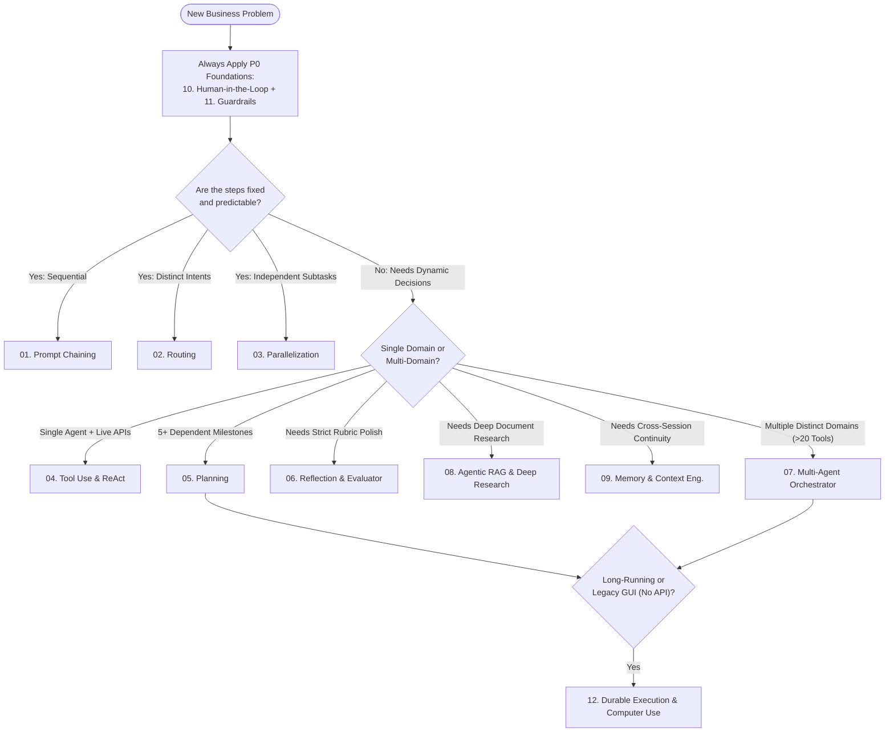

# Enterprise Agentic AI Design Patterns Playbook

AI agents shift AI from passive text generators into active business problem-solvers that reason, plan, and execute multi-step workflows safely and reliably.

> **Golden Rule: Deterministic first, agentic where needed. Every pattern justified by the Scorecard.**

---

## From Idea to Production: What It Really Takes to Ship Enterprise AI

For the last few years, I have had the privilege of serving as a Consulting Director within Enterprise AI Architecture, leading talented teams of AI engineers to turn ambitious ideas into production-ready solutions.

When people hear AI, they often think about models, demos, and launch days. But the real work begins long before the launch—and continues long after it.

My journey often starts with a whiteboard conversation with product and engineering teams. An idea takes shape. A business problem becomes clearer. Then comes the hard part: designing, building, and delivering an enterprise AI solution that customers can trust and teams can operate at scale.

That means getting the architecture, data, prompts, security, and governance right. Just as importantly, it means getting the people, processes, and business objectives right.

My responsibility is to simplify that complexity into an architecture that delivers business value without introducing unnecessary risk.

Here are three lessons that have shaped my perspective:

1. **Enterprise AI is a journey, not a demo**. Success requires close collaboration with customers—from discovery and architecture through pilots, production scaling, adoption, and long-term value realization. Every stage matters.
2. **Technology alone does not guarantee success**. I have seen what works, what fails, and why. Many AI initiatives struggle not because the technology is inadequate, but because the journey from idea to production was never designed end to end. Gaps in ownership, governance, integration, reliability, and adoption can undermine even the most promising solutions.
3. **Simplicity is an architectural advantage**. Building enterprise AI requires judgment: knowing when to introduce additional complexity and when a simpler solution will deliver better results. The goal is not to use more AI or more sophisticated patterns. The goal is to solve the right problem, reliably and responsibly, at the right cost.

These lessons inspired me to document the frameworks, decisions, and playbooks I have developed through enterprise AI engagements.

📘 My upcoming book, publishing on Amazon in Q3 2027, brings these lessons together to help architects and technology leaders navigate the customer journey, lead engineering teams, design for enterprise scale, and turn promising AI concepts into production systems that deliver measurable business value.

Because the real measure of AI success isn't whether a demo works. It's whether the solution earns customer trust, achieves adoption, and delivers sustained business outcomes.

> **The Architect's Litmus Test:** *What measurable improvement in task completion, cycle time, reliability, or cost justifies introducing a more complex AI pattern instead of keeping the solution simpler?*

I'm curious: What has been the biggest challenge in your journey from AI proof of concept to production—architecture, data, governance, integration, or adoption?

---

## The 12 Major Agentic AI Design Patterns

| # | Pattern Folder | Core Analogy | Primary Business Value | Complexity Tier |
|---|---|---|---|---|
| **01** | [01. Prompt Chaining](./01-prompt-chaining/) | Factory assembly line with quality stations | High predictability & compliance on repeatable multi-step tasks | Tier 1: Workflow |
| **02** | [02. Routing](./02-routing/) | Smart hospital triage nurse / receptionist | Cuts AI spend 50–75% by matching request difficulty to the right specialist or model | Tier 1: Workflow |
| **03** | [03. Parallelization (Fan-Out / Fan-In)](./03-parallelization/) | Formula 1 pit crew / panel of independent inspectors | Slashes wait times and catches blind spots via simultaneous analysis | Tier 1: Workflow |
| **04** | [04. Tool Use & ReAct](./04-tool-use-react/) | Detective with live database access & calculator | Eliminates data hallucinations and executes real transactions via APIs/MCP | Tier 2: Single Agent |
| **05** | [05. Planning (Plan-and-Execute)](./05-planning/) | Architect drafting a blueprint before laying bricks | Solves complex 5+ step goals with upfront previews and dynamic recovery | Tier 2: Single Agent |
| **06** | [06. Reflection & Evaluator-Optimizer](./06-reflection-evaluator-optimizer/) | Writer paired with a strict chief editor | Catches 70–90% of first-draft errors against a rubric before human review | Tier 2: Single Agent |
| **07** | [07. Multi-Agent Orchestrator & Handoffs](./07-multi-agent-orchestrator/) | General contractor managing licensed trade specialists | Scales across deep domains & security boundaries without prompt bloat | Tier 3: Multi-Agent |
| **08** | [08. Agentic RAG & Deep Research](./08-agentic-rag-deep-research/) | Investigative journalist cross-checking sources | Delivers 100% cited, permission-filtered answers from internal & web data | Tier 2/3: Knowledge |
| **09** | [09. Memory & Context Engineering](./09-memory-context-engineering/) | Concierge doctor's chart + clean working desk | Remembers user preferences across sessions while cutting token bloat 75%+ | Tier 2/3: State |
| **10** | [10. Human-in-the-Loop & Governance](./10-human-in-the-loop-governance/) | Corporate expense approval limits by dollar tier | Automates 85%+ of routine work while gating high-risk actions behind 1-click sign-off | P0: Governance |
| **11** | [11. Guardrails & Policy-as-Code](./11-guardrails-policy-as-code/) | Airport security scanners + building circuit breakers | Blocks prompt injections, PII leaks, and unauthorized spend in testable code | P0: Safety |
| **12** | [12. Durable Execution & Computer Use](./12-durable-execution-computer-use/) | GPS-tracked freight train with universal track adapters | Survives crashes over multi-hour jobs and automates legacy "no-API" portals | Tier 4: Autonomous |

---

## Executive Decision Tree: Choosing the Right Pattern

#### Enterprise Evaluation Scorecard

Before promoting any agent pattern to production—or upgrading from a simpler pattern to a more complex one—measure performance across these dimensions:

| Dimension | Business & Operational Metrics |
|---|---|
| **Business Value** | Task completion rate, straight-through resolution rate, cycle-time reduction, CSAT, ROI |
| **Accuracy & Quality** | Evidence-grounded citation rate, tool/schema accuracy, rubric pass rate, correction rate |
| **Reliability** | End-to-end success rate, timeout recovery, zero duplicate side-effects (idempotency), rollback rate |
| **Performance (Latency)** | p50/p95 response time, time to first progress update |
| **Cost** | Cost per completed task (`\$`/task), tokens per task, tool calls per task (note: multi-agent fan-out grows $O(n)$ to $O(n^2)$) |
| **Security & Governance** | Zero unauthorized actions, zero PII/PHI leaks, 100% high-risk approval compliance |
| **Maintainability** | Change-failure rate, regression escapes, mean time to detect (MTTD), 1-click rollback time |

### Foundations, Tool Use & Model Context Protocol (MCP)

| Week | Industry | Problem Statement & The Opportunity | Business Capabilities Enabled | AI Agent Pattern Reference Name |
| :--- | :--- | :--- | :--- | :--- |
| **01** | **Retail** | Unstructured customer return comments hide batch defects; automating triage cuts defective inventory write-offs by 18%. | Reverse Logistics Triage, SKU Defect Detection, Supplier Quality Scoring | Deterministic Structured Outputs (`response_schema`) |
| **02** | **Banking** | Static fee tables cause 40% digital onboarding abandonment; stateful advisory boosts account completion by 30%. | Digital Onboarding, Product Suitability Matching, Audit Session Persistence | Stateful Multi-Turn Conversational Memory |
| **03** | **FinTech** | Manual cross-system payout debugging takes hours; automated ledger/KYC tool lookups drop MTTR to 45 seconds. | Payment Exception Handling, Ledger Reconciliation, Webhook Diagnostics | Native Function Calling (`tools`) |
| **04** | **Insurance** | Manual property hazard checks bottleneck underwriters; autonomous multi-step verification speeds triage by 5x. | Automated Risk Triage, Hazard Verification, Underwriting Pre-Screening | Explicit ReAct Loop (`Thought -> Action -> Observation`) |
| **05** | **FinTech** | Compliance teams miss real-time regulatory bulletins; grounded web scanning eliminates manual tracking and hallucinated links. | Regulatory Horizon Scanning, Change Management, Verified Citation Grounding | Search-Grounded Verification Agent |
| **06** | **Services** | Routing L1 helpdesk resets to heavy models wastes compute; tiered routing cuts inference costs by 80% while meeting P1 SLAs. | Intelligent Ticket Triage, SLA Governance, Model FinOps Routing | Dual-Model Complexity Router (`flash-lite` + `flash`) |
| **07** | **Banking** | Treasury analysts spend days reconciling settlement CSV breaks; sandboxed code generation automates discrepancy math in seconds. | Nostro/Vostro Reconciliation, Exception Calculation, Automated Financial Scripting | Sandboxed Code-Execution Agent |
| **08** | **Insurance** | Auto damage photo backlog delays claims by 5 days; multimodal visual appraisal generates line-item estimates in 10 seconds. | First Notice of Loss (FNOL) Triage, Visual Damage Appraisal, Parts Pricing Lookup | Multimodal Vision-to-Tool Agent |
| **09** | **Healthcare** | Evening EHR charting causes severe physician burnout; ambient audio extraction recovers 2 hours daily via instant SOAP notes. | Clinical Documentation Improvement (CDI), ICD-10 Coding Assist, FHIR Ingestion | Multimodal Audio-to-Structured-Schema Agent |
| **10** | **Retail** | Manual store aisle audits miss stockouts; long-context video perception boosts on-shelf availability by 4%. | Planogram Compliance, Visual Merchandising Audit, Store Replenishment Alerts | Long-Context Temporal Video Perception Agent |
| **11** | **Healthcare** | Legacy EHR silos block safe AI access; wrapping patient vitals and allergies in MCP standardizes clinical tool interoperability. | Clinical Data Interoperability, Standardized Tool Exposure, Drug-Allergy Checking | Model Context Protocol (MCP) Server (`stdio`) |
| **12** | **Retail** | Disconnected inventory databases and vendor files delay reorders; an MCP Host bridges SQLite stock and file systems automatically. | Automated Inventory Replenishment, Purchase Order Drafting, Multi-System Orchestration | Dynamic Multi-Server MCP Client Host |
| **13** | **FinTech** | Preparing AML Suspicious Activity Reports takes 3 hours per alert; unifying MCP ledgers and web screening cuts prep to 3 minutes. | AML Case Investigation, Adverse Media Screening, Regulatory SAR Filing | Composite Tool + Grounding + Schema Copilot |

### Agentic RAG, Knowledge Graphs & Enterprise Memory

| Week | Industry | Problem Statement & The Opportunity | Business Capabilities Enabled | AI Agent Pattern Reference Name |
| :--- | :--- | :--- | :--- | :--- |
| **14** | **Insurance** | Naive text splitting breaks policy exclusion clauses; semantic boundary chunking prevents costly coverage misinterpretations. | Policy Document Ingestion, Legal Clause Preservation, High-Precision Indexing | Agentic Semantic Boundary Chunker |
| **15** | **Retail** | Keyword search fails on nuanced shopper style prompts; self-querying metadata extraction lifts e-commerce conversion by 12%. | Conversational Commerce, Dynamic Attribute Extraction, Catalog Discovery | Self-Querying Metadata Filter RAG |
| **16** | **Healthcare** | Outdated local hospital protocols risk patient safety; grading retrieved chunks with web fallback ensures current clinical guidance. | Clinical Decision Support (CDS), Evidence Relevance Grading, Literature Fallback | Corrective RAG (CRAG) |
| **17** | **Banking** | Unverified AI claims violate wealth management rules; self-reflection loops verify every sentence against fund prospectuses. | Fiduciary Compliance Review, Hallucination Prevention, Strict Source Attribution | Self-Reflective RAG (Self-RAG) |
| **18** | **Services** | Vector search misses exact legal statute numbers; combining BM25 lexical search with dense embeddings optimizes precedent discovery. | Legal Discovery, Contract Clause Retrieval, Cross-Encoder Reranking | Hybrid Lexical-Vector Reranking RAG |
| **19** | **FinTech** | Shell-company ownership rings hide in raw registry text; automated entity-relation extraction maps beneficial ownership graphs. | Ultimate Beneficial Owner (UBO) Discovery, Entity Resolution, AML Network Mapping | Knowledge Graph Triple Extractor |
| **20** | **Retail** | Tier-2 supplier shutdowns cause blind SKU delays; natural-language-to-graph traversal quantifies downstream revenue at risk instantly. | Multi-Tier Supply Chain Visibility, Blast-Radius Impact Analysis, Risk Mitigation | GraphRAG (Cypher/Network Traversal Agent) |
| **21** | **Banking** | Branch leaders wait days for BI SQL reports; self-correcting SQL generation democratizes instant deposit and delinquency analytics. | Self-Service Financial BI, Autonomous Schema Introspection, Syntax Error Recovery | Self-Correcting Text-to-SQL Loop |
| **22** | **Retail** | Associates forget VIP shopper sizing and past return frustrations; dual memory lifts repeat luxury clienteling spend by 22%. | VIP Clienteling Personalization, Long-Term Preference Profiling, Interaction History | Dual Episodic & Semantic Memory Architecture |
| **23** | **Services** | Re-indexing massive 400-page client RFPs wastes tokens; pinning full discovery repositories in cache slashes query latency and cost by 75%. | Enterprise Bid Management, RFP Compliance Matrix Generation, Inference FinOps | Long-Context Prefix Caching Agent |
| **24** | **FinTech** | Key unit economics hide inside pitch deck bar charts; visual slide indexing unlocks rapid M&A due diligence across PDF decks. | Investment Due Diligence, Visual Chart & Table Indexing, Financial Benchmarking | Multimodal Vision RAG |
| **25** | **Healthcare** | Months of noisy wearable telemetry overwhelm care nurses; nightly memory compaction distills 90 days of logs into a 1-page brief. | Remote Patient Monitoring (RPM), Longitudinal Summarization, Physician Handoff | Background Memory Consolidation & Pruning Loop |
| **26** | **Insurance** | Underwriters juggle disconnected PDFs, broker networks, and loss tables; a unified router synthesizes all three in one query. | Commercial Lines Underwriting, Multi-Source Risk Synthesis, Holistic Exposure View | Unified Vector + GraphRAG + SQL Router |

### Multi-Agent Systems & Enterprise Orchestration

| Week | Industry | Problem Statement & The Opportunity | Business Capabilities Enabled | AI Agent Pattern Reference Name |
| :--- | :--- | :--- | :--- | :--- |
| **27** | **Retail** | Manual handoffs delay seasonal product launches by weeks; chained specialist agents generate localized omnichannel copy in 60 seconds. | Product Information Management (PIM), SEO Copywriting, Multi-Region Localization | Sequential Prompt-Chaining Pipeline |
| **28** | **Services** | Ambiguous client SOWs cause project scope creep; decomposing specs into estimated agile epics accelerates delivery kickoff. | Technical Project Scoping, Agile Backlog Generation, Effort Estimation | Planner-Executor Hierarchical Pattern |
| **29** | **Banking** | Translating legacy credit policies into tested code takes weeks; automated test-critique loops deliver 100% verified scoring rules. | Credit Policy Automation, Automated Unit Test Generation, Code Verification | Generator-Critic Reflection Loop |
| **30** | **Insurance** | Sequential peril reviews slow commercial quotes; parallel Fire, Flood, and Solvency sub-agents issue binding quotes 3x faster. | Multi-Peril Risk Assessment, Concurrent Underwriting, Automated Quote Aggregation | Parallel Fan-Out / Map-Reduce Orchestration |
| **31** | **Healthcare** | Uncoordinated Pharmacy, PT, and Billing sign-offs delay hospital discharges; a Supervisor agent orchestrates real-time bed clearance. | Inpatient Care Coordination, Discharge Bottleneck Resolution, Bed Turnaround Ops | Centralized Supervisor State Graph |
| **32** | **FinTech** | Investment committees suffer from confirmation bias; structured Bull vs. Bear agent debate produces balanced, risk-weighted memos. | Investment Committee Governance, Adversarial Risk Analysis, Thesis Synthesis | Multi-Agent Adversarial Debate & Judge |
| **33** | **Banking** | Autonomous agents cannot legally bind high-value commercial loans; stateful execution pauses enforce human maker-checker sign-off. | Credit Approval Governance, Maker-Checker Compliance, Stateful Checkpointing | Human-in-the-Loop (HITL) Interrupt Graph |
| **34** | **Services** | Legacy framework migrations burn thousands of consulting hours; cyclic compile-and-repair loops automate 60% of code refactoring. | Legacy Application Modernization, Automated Dependency Upgrades, Self-Healing Builds | Cyclic State Machine with Compiler Feedback |
| **35** | **Retail** | Customers hate repeating order details across support transfers; decentralized context handoffs unify Orders, Refunds, and Styling. | Omnichannel Contact Center, Warm Context Transfer, Customer Retention | Decentralized Swarm Handoff Pattern |
| **36** | **Healthcare** | Manual Prior Authorization back-and-forth delays care by 14 days; cross-system agent negotiation resolves medical necessity in minutes. | Utilization Management, Automated Prior Authorization, Payer-Provider Interop | Agent-to-Agent (A2A) JSON-RPC Protocol |
| **37** | **FinTech** | Siloed war-room chats prolong payment gateway outages; a shared blackboard lets SRE, DB, and Comms agents isolate root causes together. | Major Incident Management, Collaborative Root-Cause Triage, Automated Status Comms | Shared Blackboard Collaborative Architecture |
| **38** | **Insurance** | Hurricane claim surges crash API rate limits; a priority token-bucket governor queues emergency FNOL claims with zero 429 errors. | Catastrophe Claims Surge Management, API Quota Governance, Priority Triage Queuing | Token-Bucket Rate Governor & Priority Queue |
| **39** | **Services** | Consulting partners spend 40 hours building transformation proposals; a multi-agent crew generates architecture decks in 5 minutes. | Pre-Sales Solution Architecture, Proposal Automation, Executive Slide Generation | Multi-Agent Role Crew with Document Compiler |

### Enterprise Guardrails, FinOps, Evaluation & Production Scale

| Week | Industry | Problem Statement & The Opportunity | Business Capabilities Enabled | AI Agent Pattern Reference Name |
| :--- | :--- | :--- | :--- | :--- |
| **40** | **Banking** | Regulators reject black-box credit AI; OpenTelemetry span tracing provides full audit lineage of every prompt and tool call. | Model Risk Management (MRM), Fiduciary Audit Lineage, Latency Observability | OpenTelemetry Instrumentation & Span Tracing |
| **41** | **Healthcare** | Clinical leaders cannot deploy unverified triage bots; automated golden-dataset grading proves 100% dosage and protocol faithfulness. | Clinical AI Safety Validation, Automated Regression Benchmarking, Faithfulness Scoring | LLM-as-a-Judge Evaluation Pipeline |
| **42** | **Retail** | Prompt-injection attackers trick retail bots into issuing 99% discounts; pre-flight guardrail classifiers block promo abuse in 120ms. | Brand & Margin Protection, Adversarial Jailbreak Defense, Policy Enforcement | Dual Input/Output Guardrail Proxy |
| **43** | **Healthcare** | Cloud APIs cannot receive raw patient PHI under HIPAA; local PII scrubbing anonymizes data on-premise before cloud inference. | HIPAA Privacy Compliance, Local PHI De-Identification, Token Re-Hydration | Zero-Trust Local PII Scrubbing Middleware |
| **44** | **Retail** | Black Friday order status floods spike latency and API usage; vector semantic caching deflects 65% of repeat queries in 6ms at $0 cost. | Peak Traffic Resiliency, Inference FinOps Optimization, Sub-10ms Response Caching | Vector Similarity Semantic Cache Proxy |
| **45** | **Banking** | Data-residency rules forbid cloud processing of raw account PII; sovereign routing splits sensitive queries to local models and research to cloud. | Data Sovereignty Compliance, Air-Gapped Failover, Hybrid Cloud Orchestration | Hybrid Cloud-to-Local Sovereign Router |
| **46** | **Insurance** | Brokers waste hours re-keying ACORD PDFs into legacy portals without APIs; headless visual browser agents automate form entry end-to-end. | Legacy Carrier Portal RPA, ACORD Form Extraction, Straight-Through Processing | Multimodal Headless Browser Automation Agent |
| **47** | **FinTech** | Merchants lose 70% of chargebacks by missing dispute deadlines; webhook-triggered agents compile shipping and auth rebuttal packets automatically. | Chargeback Representment, Automated Evidence Packaging, Merchant Revenue Recovery | Event-Driven Webhook Autonomous Worker |
| **48** | **Retail** | High-consideration shoppers want natural spoken styling advice; low-latency bi-directional voice streaming enables interruptible voice commerce. | Conversational Voice Concierge, Hands-Free Catalog Discovery, VIP Accessibility | Real-Time Bi-Directional Multimodal Live Agent |
| **49** | **Services** | Proprietary client file formats break standard ETL pipelines; meta-agents write, sandbox-test, and register custom Python parsers on the fly. | Automated Client Data Onboarding, Dynamic Tool Synthesis, Self-Healing ETL | Self-Evolving Meta-Tool Creator Agent |
| **50** | **FinTech** | Long-running M&A research jobs lose progress on network drops; durable SQLite DAG checkpointing guarantees crash-resilient resumption. | Institutional M&A Due Diligence, Fault-Tolerant Batch Execution, State Recovery | Durable Checkpointed DAG Worker Queue |
| **51** | **Insurance** | InsurTechs struggle to productize notebook agents for mobile apps; distroless containers on serverless free tiers deliver auto-scaling REST APIs. | AI Microservice Productization, OpenAPI Contract Publishing, Zero-Cost Auto-Scaling | Containerized Serverless Agent Microservice |
| **52** | **Enterprise** | Fragmented departmental bots create shadow AI risk; a unified control plane governs MCP tools, GraphRAG, PII guardrails, and telemetry. | Enterprise AI Governance, Multi-Agent Control Plane, Standardized Reference Platform | Governed Enterprise Agentic Reference Architecture |

---

## Adoption Sequence & Architectural Reference Catalog

**P0: Safety + Tools → P1: Reasoning / Planning / Orchestration / Reliability → P2: RAG / Memory / Eval → P3: Multi-Agent → P4: Advanced**

### P0: Safety (Must Have — Patterns [10](./10-human-in-the-loop-governance/) & [11](./11-guardrails-policy-as-code/))

- **Human-in-the-Loop** — Gate irreversible or high-risk actions behind explicit human approval.
  - Ref: [Constitutional AI, arXiv:2212.08073](https://arxiv.org/abs/2212.08073)
- **Risk-Tiered Autonomy** — Scale agent freedom to action risk (read < write < spend/delete).
  - Ref: [AgentDojo, arXiv:2406.13352](https://arxiv.org/abs/2406.13352)
- **Least-Privilege Tooling + Identity Propagation + Secrets Isolation** — Agents act only with the caller's scoped identity; secrets never enter model context.
  - Ref: [Defeating Prompt Injections by Design (CaMeL), arXiv:2503.18813](https://arxiv.org/abs/2503.18813)
- **Sandboxed Execution & Runtime Isolation** — Execute untrusted code, shell commands, and browser sessions inside isolated containers/microVMs with strict filesystem and network egress boundaries.
  - Ref: [SWE-agent, arXiv:2405.15793](https://arxiv.org/abs/2405.15793)
  - Ref: [OSWorld, arXiv:2404.07972](https://arxiv.org/abs/2404.07972)
- **Policy-as-Code + Guardrails** — Enforce rules outside the prompt, in programmable and testable rails.
  - Ref: [NeMo Guardrails, arXiv:2310.10501](https://arxiv.org/abs/2310.10501)
  - Ref: [Llama Guard, arXiv:2312.06674](https://arxiv.org/abs/2312.06674)
- **Prompt-Injection Defense** — Treat all retrieved/tool content as untrusted data, never as instructions.
  - Ref: [Indirect Prompt Injection, arXiv:2302.12173](https://arxiv.org/abs/2302.12173)
  - Ref: [The Instruction Hierarchy, arXiv:2404.13208](https://arxiv.org/abs/2404.13208)
  - Ref: [Spotlighting, arXiv:2403.14720](https://arxiv.org/abs/2403.14720)
- **Audit Trace** — Log every decision, tool call, and approval for replay and forensics.

### P0: Tools (Patterns [04](./04-tool-use-react/) & [12](./12-durable-execution-computer-use/))

- **Tool Use** — Let the model call external APIs/functions to act and fetch facts.
  - Ref: [Toolformer, arXiv:2302.04761](https://arxiv.org/abs/2302.04761)
  - Ref: [Gorilla, arXiv:2305.15334](https://arxiv.org/abs/2305.15334)
  - Ref: [ToolLLM, arXiv:2307.16789](https://arxiv.org/abs/2307.16789)
- **CodeAct** — Use executable code as the unified action space.
  - Ref: [CodeAct, arXiv:2402.01030](https://arxiv.org/abs/2402.01030)
- **Agent-Computer Interface (ACI) + Computer Use** — Design token-efficient, ergonomic action/observation wrappers (or GUI/browser automation) tailored to how models perceive state and recover from errors.
  - Ref: [SWE-agent (ACI), arXiv:2405.15793](https://arxiv.org/abs/2405.15793)
  - Ref: [OSWorld, arXiv:2404.07972](https://arxiv.org/abs/2404.07972)
  - Ref: [WebArena, arXiv:2307.13854](https://arxiv.org/abs/2307.13854)
- **Parallel Function Calling** — Run independent tool calls concurrently to cut latency.
  - Ref: [LLMCompiler, arXiv:2312.04511](https://arxiv.org/abs/2312.04511)
- **Contract-Grounded + Structured Output + Read-Validate-Write-Verify** — Validate schemas before and after every side-effecting call.
  - Ref: [CRITIC, arXiv:2305.11738](https://arxiv.org/abs/2305.11738)
- **MCP + A2A** — Standard protocols for tool access (MCP) and agent-to-agent interop (A2A).
  - Ref: [Model Context Protocol spec](https://modelcontextprotocol.io)
  - Ref: [A2A Protocol spec](https://a2a-protocol.org)

### P1: Core Reasoning (Patterns [04](./04-tool-use-react/) & [06](./06-reflection-evaluator-optimizer/))

- **ReAct** — Interleave reasoning with tool actions and observations.
  - Ref: [arXiv:2210.03629](https://arxiv.org/abs/2210.03629)
- **Inference-Time Scaling / Test-Time Compute** — Allocate dynamic thinking budgets, search, and verification at inference time based on task difficulty rather than relying solely on larger pre-trained models.
  - Ref: [Scaling LLM Test-Time Compute, arXiv:2408.03314](https://arxiv.org/abs/2408.03314)
  - Ref: [DeepSeek-R1, arXiv:2501.12948](https://arxiv.org/abs/2501.12948)
  - Ref: [s1: Simple Test-Time Scaling, arXiv:2501.19393](https://arxiv.org/abs/2501.19393)
- **Self-Ask** — Decompose a question into sub-questions answered one at a time.
  - Ref: [arXiv:2210.03350](https://arxiv.org/abs/2210.03350)
- **Self-Consistency** — Sample multiple reasoning paths and take the majority answer.
  - Ref: [arXiv:2203.11171](https://arxiv.org/abs/2203.11171)
- **Self-Refine** — Generate, critique, and revise with the same model.
  - Ref: [arXiv:2303.17651](https://arxiv.org/abs/2303.17651)
- **Reflexion** — Store verbal lessons from failures to improve the next attempt.
  - Ref: [arXiv:2303.11366](https://arxiv.org/abs/2303.11366)
- **Self-Debug** — Use execution feedback to repair generated code.
  - Ref: [arXiv:2304.05128](https://arxiv.org/abs/2304.05128)
- **Tree of Thoughts** — Explore and backtrack across branching reasoning paths.
  - Ref: [arXiv:2305.10601](https://arxiv.org/abs/2305.10601)
- **Graph of Thoughts** — Merge, refine, and reuse thoughts as a graph.
  - Ref: [arXiv:2308.09687](https://arxiv.org/abs/2308.09687)
- **Evidence-Grounded + Stop-When-Sufficient + Ask-Before-Assuming** — Cite evidence, halt when enough, and clarify ambiguity instead of guessing.

### P1: Planning (Pattern [05](./05-planning/))

- **Plan-and-Execute / Plan-and-Solve** — Plan first, then execute steps, replanning only on failure.
  - Ref: [Plan-and-Solve, arXiv:2305.04091](https://arxiv.org/abs/2305.04091)
  - Ref: [ReWOO, arXiv:2305.18323](https://arxiv.org/abs/2305.18323)
- **Hierarchical Decomposition (Least-to-Most)** — Break a hard task into ordered, simpler subtasks.
  - Ref: [Least-to-Most, arXiv:2205.10625](https://arxiv.org/abs/2205.10625)
  - Ref: [Chain-of-Thought, arXiv:2201.11903](https://arxiv.org/abs/2201.11903)
- **Dependency-Aware / Symbolic Planning** — Offload planning to a classical planner for validity guarantees.
  - Ref: [LLM+P, arXiv:2304.11477](https://arxiv.org/abs/2304.11477)
  - Ref: [LLM-Modulo, arXiv:2402.01817](https://arxiv.org/abs/2402.01817)
- **Parallel Planning** — Compile a task DAG and run independent steps concurrently.
  - Ref: [LLMCompiler, arXiv:2312.04511](https://arxiv.org/abs/2312.04511)
- **Plan Validation + Precondition-Action-Postcondition + Draft-Preview-Approve-Commit** — Check feasibility before acting and preview before committing.
  - Ref: [SayCan, arXiv:2204.01691](https://arxiv.org/abs/2204.01691)

### P1: Orchestration (Patterns [01](./01-prompt-chaining/), [02](./02-routing/), [03](./03-parallelization/), [06](./06-reflection-evaluator-optimizer/), [07](./07-multi-agent-orchestrator/), [08](./08-agentic-rag-deep-research/), [12](./12-durable-execution-computer-use/))

- **Deterministic Workflow with Agentic Steps** — Fixed control flow, with LLM judgment only inside bounded nodes.
  - Ref: [Anthropic, Building Effective Agents](https://www.anthropic.com/engineering/building-effective-agents)
- **Prompt Chaining & Routing** — Sequence narrow LLM steps with programmatic gates, or classify inputs up front to dispatch to specialized prompts/models.
  - Ref: [Anthropic, Building Effective Agents](https://www.anthropic.com/engineering/building-effective-agents)
- **Supervisor Orchestrator** — One coordinator routes work to specialist workers.
  - Ref: [AutoGen, arXiv:2308.08155](https://arxiv.org/abs/2308.08155)
  - Ref: [Magentic-One, arXiv:2411.04468](https://arxiv.org/abs/2411.04468)
- **Evaluator-Optimizer** — A generator and a separate evaluator loop until criteria pass.
  - Ref: [Self-Refine, arXiv:2303.17651](https://arxiv.org/abs/2303.17651)
- **Fan-Out / Fan-In (Sectioning & Voting)** — Run parallel workers on independent subtasks or ensemble perspectives and aggregate results.
  - Ref: [Mixture-of-Agents, arXiv:2406.04692](https://arxiv.org/abs/2406.04692)
- **Iterative Deep Research (Scope-Plan-Search-Critique-Synthesize)** — Multi-step investigative loop that decomposes open-ended queries, executes parallel retrieval/browsing, verifies coverage gaps, and synthesizes cited reports.
  - Ref: [BrowseComp, arXiv:2504.12516](https://arxiv.org/abs/2504.12516)
  - Ref: [Agentic RAG Survey, arXiv:2501.09136](https://arxiv.org/abs/2501.09136)
- **Event-Driven + Queue + Durable + Checkpoint-Resume** — Persist state and progress artifacts across sessions so long-running tasks survive crashes, context resets, and human waits.
  - Ref: [MemGPT, arXiv:2310.08560](https://arxiv.org/abs/2310.08560)
- **Saga / Compensation + Human Escalation** — Undo partial side-effects on failure and escalate to a human.

### P1: Reliability (Patterns [02](./02-routing/), [11](./11-guardrails-policy-as-code/), [12](./12-durable-execution-computer-use/))

- **Timeouts, Retry Classification, Backoff/Jitter, Circuit Breaker, Idempotency, Durable Replay, Health Checks** — Standard distributed-systems hygiene applied to agent loops.
- **Hard Operational Budgets & Loop Breakers** — Enforce strict caps on steps, wall-clock time, token spend, and repeated identical tool calls to prevent runaway loops.
- **Fallback / Cascade Routing** — Try cheap models first and escalate only when needed.
  - Ref: [FrugalGPT, arXiv:2305.05176](https://arxiv.org/abs/2305.05176)
  - Ref: [RouteLLM, arXiv:2406.18665](https://arxiv.org/abs/2406.18665)

### P2: RAG & Memory (Patterns [08](./08-agentic-rag-deep-research/) & [09](./09-memory-context-engineering/))

- **RAG** — Ground generation in retrieved documents.
  - Ref: [arXiv:2005.11401](https://arxiv.org/abs/2005.11401)
- **Agentic RAG / Self-RAG** — The model decides when to retrieve and critiques what it retrieved.
  - Ref: [Self-RAG, arXiv:2310.11511](https://arxiv.org/abs/2310.11511)
  - Ref: [Agentic RAG Survey, arXiv:2501.09136](https://arxiv.org/abs/2501.09136)
- **Corrective RAG** — Score retrieval quality and fall back to re-search when poor.
  - Ref: [arXiv:2401.15884](https://arxiv.org/abs/2401.15884)
- **GraphRAG** — Use knowledge graphs for multi-hop and global questions.
  - Ref: [GraphRAG, arXiv:2404.16130](https://arxiv.org/abs/2404.16130)
  - Ref: [HippoRAG, arXiv:2405.14831](https://arxiv.org/abs/2405.14831)
  - Ref: [LightRAG, arXiv:2410.05779](https://arxiv.org/abs/2410.05779)
- **Contextual Retrieval + Hybrid Search + Query Rewriting + Reranking** — Prepend chunk-specific context before indexing, combine lexical and dense retrieval, rewrite queries, and rerank for precision.
  - Ref: [Anthropic, Contextual Retrieval](https://www.anthropic.com/news/contextual-retrieval)
  - Ref: [IRCoT, arXiv:2212.10509](https://arxiv.org/abs/2212.10509)
  - Ref: [Rewrite-Retrieve-Read, arXiv:2305.14283](https://arxiv.org/abs/2305.14283)
  - Ref: [RankGPT, arXiv:2304.09542](https://arxiv.org/abs/2304.09542)
- **Access-Controlled + Provenance + Quarantine + Freshness** — Enforce ACLs at retrieval time, track sources, isolate untrusted content, and expire stale data.
- **Context Engineering + Isolation + Compaction + Working Memory** — Curate what enters the window and summarize or offload the rest.
  - Ref: [MemGPT, arXiv:2310.08560](https://arxiv.org/abs/2310.08560)
  - Ref: [Generative Agents, arXiv:2304.03442](https://arxiv.org/abs/2304.03442)
  - Ref: [Lost in the Middle, arXiv:2307.03172](https://arxiv.org/abs/2307.03172)
- **Episodic, Semantic & Temporal Graph Memory** — Extract, consolidate, and invalidate facts across sessions with temporal validity windows rather than appending raw transcripts.
  - Ref: [Zep (Temporal KG), arXiv:2501.13956](https://arxiv.org/abs/2501.13956)
  - Ref: [Mem0, arXiv:2504.19413](https://arxiv.org/abs/2504.19413)
- **Skill Library** — Store verified, reusable procedures the agent can retrieve and compose.
  - Ref: [Voyager, arXiv:2305.16291](https://arxiv.org/abs/2305.16291)

### P2: Evaluation (Applied Across All 12 Patterns)

- **Golden Tasks + Trace-Based Eval + Deterministic Verification** — Regression-test agents on fixed tasks, scoring trajectories and outcomes across multi-turn tool and environment interactions.
  - Ref: [SWE-bench, arXiv:2310.06770](https://arxiv.org/abs/2310.06770)
  - Ref: [τ-bench, arXiv:2406.12045](https://arxiv.org/abs/2406.12045)
  - Ref: [GAIA, arXiv:2311.12983](https://arxiv.org/abs/2311.12983)
  - Ref: [OSWorld, arXiv:2404.07972](https://arxiv.org/abs/2404.07972)
- **LLM-as-Judge** — Use a model to score outputs where rules can't, and calibrate against humans.
  - Ref: [G-Eval, arXiv:2303.16634](https://arxiv.org/abs/2303.16634)
  - Ref: [MT-Bench / LLM-as-a-Judge, arXiv:2306.05685](https://arxiv.org/abs/2306.05685)
- **Shadow / Canary + Versioning** — Roll out prompt, model, and tool changes gradually with fast rollback.

### P3: Multi-Agent (ONLY IF SCORECARD JUSTIFIES — Pattern [07](./07-multi-agent-orchestrator/))

- **Supervisor + Delegation with Typed Contracts** — Specialists receive typed tasks and return typed, verifiable results.
  - Ref: [Magentic-One, arXiv:2411.04468](https://arxiv.org/abs/2411.04468)
  - Ref: [MetaGPT, arXiv:2308.00352](https://arxiv.org/abs/2308.00352)
- **Scoped Handoffs (Routine + Context Transfer)** — Transfer active control to a specialist agent with a pruned, schema-validated state payload rather than nested middleman calls.
  - Ref: [OpenAI Agents SDK](https://openai.github.io/openai-agents-python/)
- **Debate** — Multiple agents argue and converge to improve factuality and reasoning.
  - Ref: [arXiv:2305.14325](https://arxiv.org/abs/2305.14325)
  - Ref: [arXiv:2305.19118](https://arxiv.org/abs/2305.19118)
- **Mixture of Agents** — Layered agents refine one another's outputs.
  - Ref: [arXiv:2406.04692](https://arxiv.org/abs/2406.04692)
- **Independent Verification** — A separate agent with separate context checks the result using tools.
  - Ref: [CRITIC, arXiv:2305.11738](https://arxiv.org/abs/2305.11738)
- **Capability Routing + Registry + Budget Control** — Route by declared capability and cap per-agent spend and steps.
- **Know the failure modes** — Study why multi-agent systems fail before adding one.
  - Ref: [Why Do Multi-Agent LLM Systems Fail? (MAST), arXiv:2503.13657](https://arxiv.org/abs/2503.13657)
- **Avoid:** Peer-to-Peer / Blackboard / Group Collaboration (poor auditability).

### P4: Advanced (ONLY AFTER P0–P3)

- Memory consolidation, adaptive RAG, compute-optimal multi-agent test-time scaling, and MoA only with measured business value.

---

## Appendix: Research Techniques (Not Production Patterns)

- **Chain-of-Thought** — [arXiv:2201.11903](https://arxiv.org/abs/2201.11903)
- **Quiet-STaR** — [arXiv:2403.09629](https://arxiv.org/abs/2403.09629)
- **Buffer of Thoughts** — [arXiv:2406.04271](https://arxiv.org/abs/2406.04271)
- **LATS** — [arXiv:2310.04406](https://arxiv.org/abs/2310.04406)
- **ReWOO** — [arXiv:2305.18323](https://arxiv.org/abs/2305.18323)
- **LLMCompiler** — [arXiv:2312.04511](https://arxiv.org/abs/2312.04511)
- **SayCan** — [arXiv:2204.01691](https://arxiv.org/abs/2204.01691)
- **LLM+P** — [arXiv:2304.11477](https://arxiv.org/abs/2304.11477)

## Appendix: Frameworks & Systems

- **AutoGen** — [arXiv:2308.08155](https://arxiv.org/abs/2308.08155)
- **Magentic-One** — [arXiv:2411.04468](https://arxiv.org/abs/2411.04468)
- **MetaGPT** — [arXiv:2308.00352](https://arxiv.org/abs/2308.00352)
- **Letta / MemGPT** — [arXiv:2310.08560](https://arxiv.org/abs/2310.08560)
- **Zep / Graphiti** — [arXiv:2501.13956](https://arxiv.org/abs/2501.13956)
- **Mem0** — [arXiv:2504.19413](https://arxiv.org/abs/2504.19413)
- **Voyager** — [arXiv:2305.16291](https://arxiv.org/abs/2305.16291)
- **Generative Agents** — [arXiv:2304.03442](https://arxiv.org/abs/2304.03442)
- **SWE-agent** — [arXiv:2405.15793](https://arxiv.org/abs/2405.15793)
- **OpenAI Agents SDK** — [docs](https://openai.github.io/openai-agents-python/)
- **Anthropic Agent SDK** — [docs](https://docs.anthropic.com/en/docs/agents-and-tools/claude-agent-sdk)
- **Google ADK (Agent Development Kit)** — [docs](https://google.github.io/adk-docs/)
- **CrewAI** — [docs](https://docs.crewai.com/) (no arXiv)
- **LangGraph** — [docs](https://langchain-ai.github.io/langgraph/)
